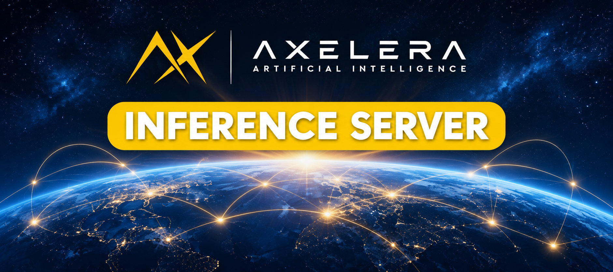
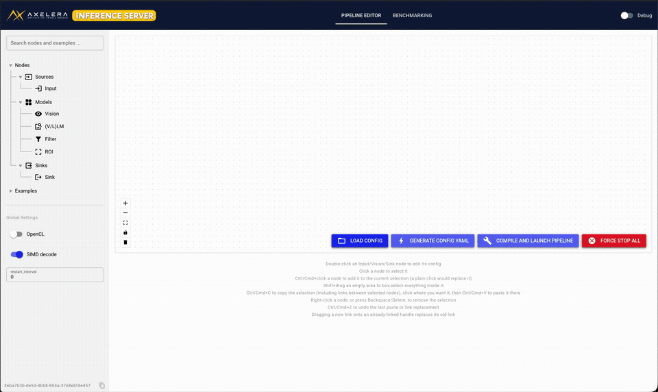
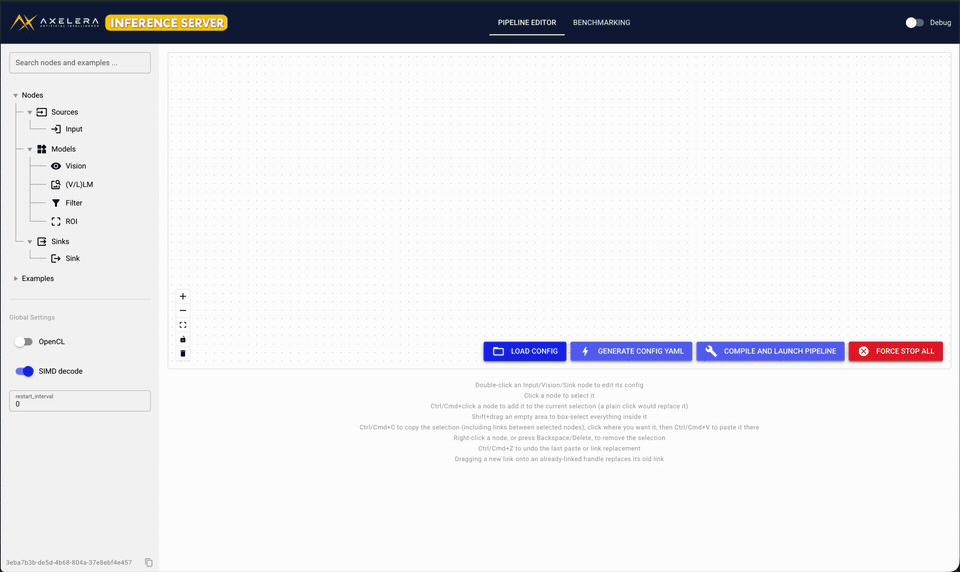
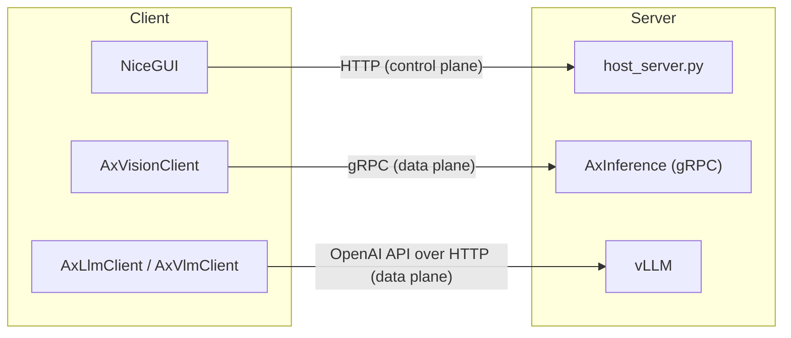

> ⚠️ **Experimental reference implementation.** `ax_inference_server` provides a
> reference implementation as-is to demonstrate serving vision, VLM, and LLM
> pipelines on the Axelera AIPU. It is not part of an Axelera product, and is
> not officially supported, and carries no warranty or maintenance
> guarantees. APIs, packages, and behavior may change or break without
> notice. Use it as a starting point and reference for your own inference
> server and application development.

# ax_inference_server

Axelera AI's inference server builds on the [Voyager SDK](https://github.com/axelera-ai-hub/voyager-sdk). It compiles and runs vision, VLM and LLM pipelines on
Axelera hardware. It exposes them over gRPC and an OpenAI-compatible HTTP API. A REST control plane and a no-code GUI
control it.

## Axelera Inference Server

- **Quickstart**: Start with [`server/QUICKSTART.md`](server/QUICKSTART.md) to bring up the server side (Docker, SDK,
  models). Continue with [`client/QUICKSTART.md`](client/QUICKSTART.md) for the GUI, the helper and the release suite.
  [`client/examples/README.md`](client/examples/README.md) lists runnable examples. A Claude Code
  [helper agent](client/docs/helper/README.md) can drive the GUI for you.
- **Full docs**: [`server/docs/`](server/docs/) covers the architecture, every `host_server.py` route, the gRPC
  contract, the vision pipeline node graph, VLM/LLM serving and a per-symbol reference with exact signatures.
  [`client/docs/`](client/docs/) covers the three Python clients, the pipeline compiler and config schema, and the GUI
  (editor, benchmarking, MCP server). It has the same per-symbol reference layer.

| Single Pipeline | ISO Vision Demo |
| --- | --- |
|  |  |

## Architecture: client and server are separate processes

The client and the server are separate processes. They often run on different machines. They share no memory and
no imports.

`host_server.py` is the control plane. It sets up the environment and deploys model artifacts. It launches and
monitors the gRPC and vLLM processes. It reports device health. It is **not** a reverse proxy for inference traffic.

After a launch, the client talks directly to the inference endpoint. `AxVisionClient` calls the C++ gRPC
`AxInference` service. `AxLlmClient` and `AxVlmClient` call vLLM's OpenAI-compatible HTTP API. `host_server.py`
stays out of that traffic.

The GUI (`client/ui/gui/app.py`) is just another `host_server.py` client. It uses the control plane to launch
pipelines and models. Then it talks to the resulting gRPC and HTTP endpoints like any other client.

## Server

The server side runs on the edge or server host. These directories hold it:

- [`deployment/`](deployment/) — `host_server.py`, the FastAPI control plane. It handles setup, model and artifact
  management and device health. It launches and monitors the gRPC and vLLM processes below. It never sits on the
  inference data path.
- [`server/src/`](server/src/), [`server/include/`](server/include/) — the C++ gRPC vision server: the node-graph
  pipeline engine and the `AxInference` service.
- [`proto/`](proto/) — the versioned gRPC contract (`axinfer/v1/`) between client and server.
- [`server/vllm/`](server/vllm/) — the `axplugin` vLLM backend and `serve.sh`. They serve compiled LLM and VLM
  artifacts over an OpenAI-compatible HTTP API.
- [`server/models/`](server/models/) — scripts that pull compiled model artifacts and deploy them into an SDK
  checkout.
- [`server/docs/`](server/docs/) — the documentation set described above.

### Main features

- A REST control plane (`host_server.py`) for setup, model and artifact management, device health, monitoring and
  the pipeline and vLLM lifecycle. One `X-API-Key`-gated API covers all of it.
- A gRPC vision inference service on a configurable node-graph pipeline: detect→crop→classify cascades, conditional
  branches and bounded loops. Results return through meta keys in a versioned protobuf contract.
- Multi-threaded, SIMD-accelerated image decoding ahead of the pipeline.
- VLM and LLM serving through vLLM's OpenAI-compatible API on Axelera hardware, for text-only and vision-language
  models.
- Device health checks, NUMA and CPU topology reports, and AxMonitor integration for hardware visibility.
- A Dockerized, idempotent setup. [`server/QUICKSTART.md`](server/QUICKSTART.md) describes it.

## Client / GUI

The client side is a Python library plus a no-code Pipeline Editor GUI built on it. The library has three inference
clients, a tracker and a pipeline compiler. [`client/QUICKSTART.md`](client/QUICKSTART.md) brings it up.
[`client/examples/README.md`](client/examples/README.md) shows runnable examples and the helper CLI
(`python -m helper`), which prepares models, configs, pipelines and vLLM servers from the command line. The
[helper agent](client/docs/helper/README.md) is a Claude Code agent. It drives the GUI through its MCP server
(`pipeline-editor-gui`), so you do not click through the GUI by hand.

These directories talk to the server above:

- [`client/inference/`](client/inference/) — the three Python clients: `AxVisionClient`/`AsyncAxVisionClient`
  (gRPC vision), `AxLlmClient`/`AsyncAxLlmClient` and `AxVlmClient`/`AsyncAxVlmClient` (HTTP, vLLM OpenAI API).
- [`client/examples/`](client/examples/README.md) — `vision_demo.py`, `vllm_demo.py` and the `helper` CLI.
- [`client/tracker/`](client/tracker/) — `AxTrack`, a local multi-object tracking module. It wraps
  `roboflow/trackers` and is not a network client.
- [`client/adapters/`](client/adapters/) — pluggable frame sources: image file, video file and webcam.
- [`client/compiler/`](client/compiler/), [`client/configs/`](client/configs/) — the pydantic pipeline-config schema
  and the compilers that turn a client-side graph config into the spec the server runs.
- [`client/ui/gui/`](client/ui/gui/) — the no-code Pipeline Editor GUI (`app.py`): a visual node-graph editor, a
  benchmarking tab and an MCP server (`agent_mcp_server.py`) that exposes the editor's API to agents.
- [`client/docs/helper/`](client/docs/helper/README.md) — the helper agent. Start here to have Claude Code build,
  launch and benchmark pipelines through the GUI. The README covers setup, recommended flags and example prompts.
  The project the agent runs is in [`agent/`](client/docs/helper/agent/): `.mcp.json`, a getting-started skill and
  the [`runbook/`](client/docs/helper/agent/runbook/index.md) topic files.
- [`client/docs/`](client/docs/) — the client-side documentation set described above.

### Main client/GUI features

- Three Python client classes for a running server: vision (gRPC), text LLM and VLM (HTTP, vLLM OpenAI API). Each
  has a sync and an async variant.
- `AxTrack` turns a stream of per-frame detections into stable, ID-tracked ones. It works with any client.
- A pydantic-validated pipeline config, compiled into the node-graph spec the server runs. An invalid config fails
  before anything launches.
- A no-code Pipeline Editor GUI with live multi-source benchmarking, and an MCP server for agent-driven control of
  the editor.

## Contributing and support

[CONTRIBUTING.md](CONTRIBUTING.md) explains how to contribute. Commits are signed off under the [DCO](DCO).
[SUPPORT.md](SUPPORT.md) says where to ask for help. This is an experimental reference implementation with
best-effort support only.

## License

ax_inference_server is released under the [Apache License 2.0](LICENSE). That license covers only the source code
in this repository. The Voyager SDK it builds on and the third-party libraries it uses keep their own licenses.
Among them are vLLM, gRPC, NiceGUI and `roboflow/trackers`.
