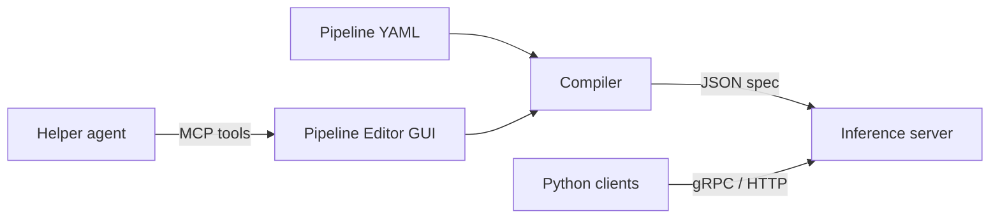

# Client docs

## Overview

The client side of this repository has four parts. The Python library talks to a running inference server. The compiler turns a pipeline YAML into a server spec. The Pipeline Editor GUI builds and benchmarks pipelines without code. The helper agent drives that GUI for you. This page lists every client docs page and reference area. It is the entry point that the GUI's `agent_mcp_server.py` serves as the MCP resource `docs://client`.

The server side has its own docs in [../../server/docs/README.md](../../server/docs/README.md). To set up the client, follow [../QUICKSTART.md](../QUICKSTART.md).

## Architecture

The GUI and the helper agent build on the library. Each concept page links to reference pages with exact signatures. Each reference area has an `index.md` that lists its pages.

## Components

Concept pages:

| Page | Description |
|---|---|
| [client/client.md](client/client.md) | Python clients `AxVisionClient`, `AxVlmClient`, `AxLlmClient` and `AxInferClient`, plus benchmark helpers. |
| [client/adapters.md](client/adapters.md) | Source adapters that read frames from images, video files and webcams. |
| [client/compiler.md](client/compiler.md) | `PipelineCompiler`, the YAML to pipeline spec flow and expression predicates. |
| [gui/pipeline-editor.md](gui/pipeline-editor.md) | The no-code canvas, its node kinds and how a graph becomes a running pipeline. |
| [gui/benchmarking.md](gui/benchmarking.md) | Live multi-source throughput and latency monitoring against a launched pipeline. |
| [gui/mcp-endpoints.md](gui/mcp-endpoints.md) | The MCP tools of `agent_mcp_server.py` that drive the GUI. |
| [helper/README.md](helper/README.md) | The helper agent: how to start it and example prompts. |
| [helper/agent/runbook/index.md](helper/agent/runbook/index.md) | Call-by-call runbooks for driving the Pipeline Editor through MCP. |

Reference areas:

| Area | Description |
|---|---|
| [reference/inference/index.md](reference/inference/index.md) | Vision, LLM and VLM clients and the generic cross-process client. |
| [reference/adapters/index.md](reference/adapters/index.md) | `SourceAdapter` and the image, video file and webcam adapters. |
| [reference/compiler/index.md](reference/compiler/index.md) | `PipelineCompiler`, `ProcessSpec`, `PredicateCompiler` and `ExprTranspiler`. |
| [reference/configs/index.md](reference/configs/index.md) | Pydantic models that validate the pipeline YAML. |
| [reference/tracker/index.md](reference/tracker/index.md) | `AxTrack` multi-object tracking. |
| [reference/helper-cli/index.md](reference/helper-cli/index.md) | The helper command-line tool. |
| [reference/gui/index.md](reference/gui/index.md) | GUI reference, including the MCP tools. |

## Flow

1. Finish the server quick start, then follow [../QUICKSTART.md](../QUICKSTART.md).
2. Read the concept page for the part you use.
3. Open the linked reference area for exact signatures and fields.
4. Use the helper agent when you want to build and benchmark pipelines through the GUI.

## Related

- [../QUICKSTART.md](../QUICKSTART.md) sets up the clients, the GUI and the helper agent.
- [../../server/docs/README.md](../../server/docs/README.md) describes the server and how the two sides connect.
- [helper/README.md](helper/README.md) describes the helper agent.

## Source files

- `client/inference/`
- `client/adapters/`
- `client/compiler/`
- `client/configs/`
- `client/tracker/`
- `client/examples/helper/`
- `client/ui/gui/`
