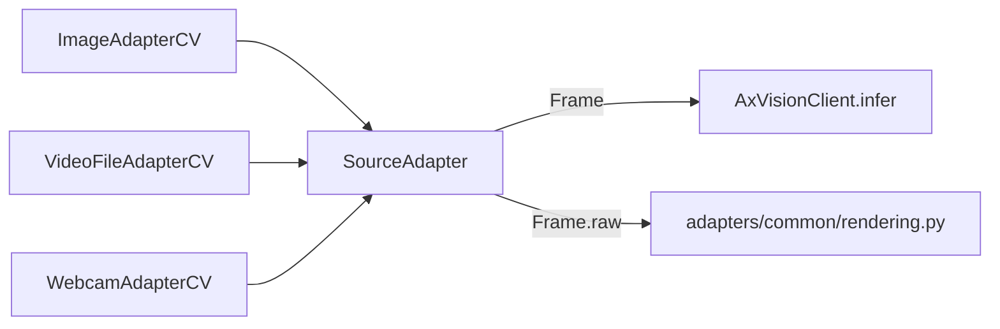

# Source adapters

## Overview

Source adapters read frames from an image file, a video file or a webcam. All adapters share the `SourceAdapter` interface. Each `read_frame()` call returns a `Frame` that holds the JPEG bytes and the decoded BGR image. The JPEG bytes go straight into `AxVisionClient.infer()`. The Pipeline Editor GUI and benchmarks use the adapters as frame sources.

## Architecture



`SourceAdapter` is an abstract base class. It tracks the open state, numbers the frames and works as a context manager. Subclasses implement the open, close and read hooks and `display_name`. The base class `read_frame()` checks that the adapter is open and sets `Frame.sequence`. The concrete adapters use OpenCV. Each adapter has a `source_kind` label: `image`, `video_file` or `webcam`. The `adapters` package re-exports the base types and the concrete adapters.

## Components

| Component | Description | Reference |
|---|---|---|
| `SourceAdapter` | Abstract base with `open()`, `close()`, `read_frame()`, `target_fps` and `display_name`. | [adapters](../reference/adapters/index.md) |
| `Frame` | Dataclass with `encoded`, `raw`, `captured_at` and `sequence`. | [adapters](../reference/adapters/index.md) |
| `SourceAdapterError` | `RuntimeError` subclass for open, read and encode failures. | [adapters](../reference/adapters/index.md) |
| `ImageAdapterCV` | Serves one still image repeatedly. | [adapters](../reference/adapters/index.md) |
| `VideoFileAdapterCV` | Reads a video file, optionally in a loop. | [adapters](../reference/adapters/index.md) |
| `WebcamAdapterCV` | Reads live frames from a camera. `list_devices()` finds `/dev/video*` devices. | [adapters](../reference/adapters/index.md) |
| `WebcamDeviceInfo` | Dataclass with `path`, `index` and `display_name` of one camera. | [adapters](../reference/adapters/index.md) |

The module `adapters/common/rendering.py` holds drawing and layout helpers for annotated frames. They draw detections, tracks, keypoints, segmentation, face landmarks and embeddings on a frame in place. They also resize, encode and save frames and lay out tiled canvases.

## Flow

1. The caller creates an adapter. The constructor reads no file or device.
2. `open()` acquires the source. `with` calls `open()` and `close()` for you.
3. `read_frame()` returns the next `Frame` with `sequence` set, starting at 0.
4. `read_frame()` returns `None` when the source ends. It raises `SourceAdapterError` on a failure.
5. `close()` releases the source. Calling it on a closed adapter does nothing.

## Configuration

| Adapter | Argument | Default | Effect |
|---|---|---|---|
| `SourceAdapter` | `target_fps` | required | Desired read rate. Must be positive, or `ValueError` is raised. |
| `ImageAdapterCV(path, ...)` | `target_fps` | `30.0` | Desired read rate. |
| `ImageAdapterCV` | `jpeg_quality` | `90` | Quality of the JPEG cached in `open()`. |
| `VideoFileAdapterCV(path, ...)` | `target_fps` | `None` | If `None`, the adapter uses the file's native FPS, or 30.0 when the file reports none. |
| `VideoFileAdapterCV` | `loop` | `True` | Restarts at the first frame at end of file instead of returning `None`. |
| `VideoFileAdapterCV` | `jpeg_quality` | `90` | JPEG quality of encoded frames. |
| `WebcamAdapterCV(device, ...)` | `device` | required | Camera index or path such as `/dev/video0`. |
| `WebcamAdapterCV` | `target_fps` | `30.0` | Frame rate that `open()` requests from the camera driver. |
| `WebcamAdapterCV` | `jpeg_quality` | `90` | JPEG quality of encoded frames. |

`read_frame(*, need_encoded=True)` skips JPEG encoding for video and webcam frames when `need_encoded` is `False`. `Frame.encoded` is then empty. `ImageAdapterCV` ignores the flag.

`WebcamAdapterCV.list_devices(*, probe=True)` returns a `WebcamDeviceInfo` per `/dev/videoN` path, sorted by path. With `probe=True` it skips devices that OpenCV cannot open.

## Constraints

- `read_frame()` does not pace itself to `target_fps`. The caller sleeps between calls for real-time playback.
- `read_frame()` raises `SourceAdapterError` if the adapter is not open.
- `ImageAdapterCV` never reports end of stream. Every read returns the same cached buffers.
- `ImageAdapterCV.open()` raises `SourceAdapterError` if OpenCV cannot read the file.
- `VideoFileAdapterCV.open()` raises `SourceAdapterError` if OpenCV cannot open the file. A read that still fails right after a rewind also raises.
- `WebcamAdapterCV` treats a failed read as a disconnected device and raises. The stream never ends normally.
- Adapters are not thread-safe. Use one adapter from one thread at a time.

## Quick Example

```python
from adapters import VideoFileAdapterCV
from inference import AxVisionClient

with AxVisionClient(["localhost:50060"]) as client, VideoFileAdapterCV("clip.mp4", loop=False) as src:
    while (frame := src.read_frame()) is not None:
        result = client.infer(frame.encoded)
```

## Related

- [client.md](client.md) describes `AxVisionClient`, the consumer of `Frame.encoded`.
- [../gui/benchmarking.md](../gui/benchmarking.md) describes the GUI source pickers built on these adapters.

## Source files

- `client/adapters/__init__.py`
- `client/adapters/base.py`
- `client/adapters/image_cv.py`
- `client/adapters/video_file_cv.py`
- `client/adapters/webcam_cv.py`
- `client/adapters/common/rendering.py`
