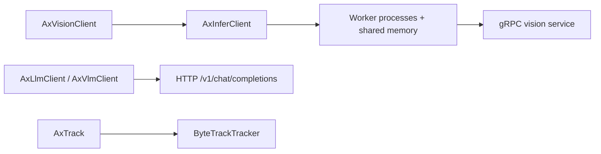

# Client classes

## Overview
The client library has three groups of classes. The vision clients send images to the gRPC inference service. The LLM and VLM clients call an OpenAI-compatible HTTP chat API. `AxTrack` adds track ids to detections locally. Each client class has a blocking and an asyncio form, except `AxTrack`. Scripts and the GUI use these classes to call a running server.

## Architecture


`AxInferClient` packs each call into shared memory. Spawned worker processes send the calls over gRPC and return responses to the caller. `AxVisionClient` fixes the engine for the vision service. The LLM and VLM clients use `httpx` directly. `AsyncAxLlmClient` and `AsyncAxVlmClient` add streaming. `AxTrack` runs in the caller's process and makes no network calls.

## Components
| Component | Description | Reference |
|---|---|---|
| `AxInferClient`, `AsyncAxInferClient` | Exported base clients for cross-process gRPC calls and `open_stream`. | [Inference reference](../reference/inference/index.md) |
| `AxVisionClient`, `AsyncAxVisionClient` | Send one image and return a `FrameResult`. | [Inference reference](../reference/inference/index.md) |
| `AxLlmClient`, `AsyncAxLlmClient` | Text-only chat completion over HTTP. | [Inference reference](../reference/inference/index.md) |
| `AxVlmClient`, `AsyncAxVlmClient` | Chat completion with images over HTTP. | [Inference reference](../reference/inference/index.md) |
| `ChatInferResult` | Result of a non-streaming chat call. | [Inference reference](../reference/inference/index.md) |
| `AxTrack`, `TrackedDetection`, `to_proto_detection` | Multi-object tracking for detections. | [Tracker reference](../reference/tracker/index.md) |

## Flow
1. The caller creates a client with endpoints or a base URL.
2. The vision client starts worker processes on the first call.
3. The caller sends an image with `infer` or pushes images into a stream.
4. The client returns a `FrameResult` or a `ChatInferResult`.
5. The caller closes the client, or leaves the `with` block.
6. For tracking, the caller passes each `FrameResult` to `AxTrack.Track` in frame order.

## Constraints
- `from inference import ...` exports only `AxInferClient`, `AsyncAxInferClient`, `AxVisionClient` and `AsyncAxVisionClient`.
- The LLM and VLM clients and `ChatInferResult` come from `inference.llm_vlm`.
- Importing `inference` prepends the `generated` directory next to it to `sys.path`. Run `gen_stubs.sh` to create the protobuf stubs.
- Only the async LLM and VLM clients stream.
- `AxTrack` needs `trackers` and `supervision`. Install them with `client/setup.sh --tracker`.
- Keep one `AxTrack` instance per video stream.

## Quick Example
```python
from inference import AxVisionClient
from inference.llm_vlm import AxLlmClient

with AxVisionClient(["localhost:50060"]) as vision:
    frame_result = vision.infer(image_bytes)

with AxLlmClient("http://localhost:8000") as llm:
    print(llm.infer("What is 2+2?").answer)
```

## Related
- [Client quickstart](../../QUICKSTART.md)
- [gRPC interface](../../../server/docs/interfaces/grpc.md)
- [vLLM serving](../../../server/docs/vllm/serving.md)
- [Pipeline editor](../gui/pipeline-editor.md)
- [Compiler](compiler.md)

## Source files
- client/inference/__init__.py
- client/inference/vision.py
- client/inference/llm_vlm.py
- client/tracker/ax_track.py
