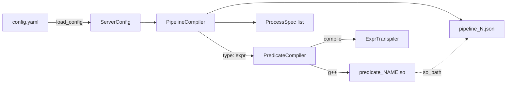

# Pipeline compiler

## Overview

The pipeline compiler turns a validated YAML config into the files that a pipeline server process runs. `PipelineCompiler` writes one JSON pipeline spec per pipeline and returns one `ProcessSpec` per pipeline. `PredicateCompiler` builds each `type: expr` predicate into a C++ shared library. The Pipeline Editor GUI and the helper deploy script call the compiler. You can also run it from the command line.

## Architecture



`load_config()` reads the YAML, expands environment variables such as `${SDK_ROOT}` in every string and validates the result as a `ServerConfig`. The schema models live in `client/configs/utils/config_schema.py`. They include `GlobalSettings`, `NetConfig`, `PipelineConfig`, `GraphNodeConfig` and the predicate configs.

`PipelineCompiler` builds the spec for each pipeline from the `pipelines:` list. The spec holds the entry node, a `global` block, the nets and predicates that the graph references, and the node list. For a predicate of type `expr`, the compiler calls `PredicateCompiler` and writes a `plugin` predicate entry that points at the built `.so`. The compiler dumps other predicate configs as they are.

## Components

| Component | Description | Reference |
|---|---|---|
| `PipelineCompiler` | Compiles a `ServerConfig` into JSON specs and `ProcessSpec` objects. | [compiler](../reference/compiler/index.md) |
| `ProcessSpec` | Launch description of one compiled pipeline process. | [compiler](../reference/compiler/index.md) |
| `ExprTranspiler` | Translates an `expr` predicate into C++ source. | [compiler](../reference/compiler/index.md) |
| `PredicateCompiler` | Builds the transpiled predicate into a shared library with `g++`. | [compiler](../reference/compiler/index.md) |
| `ServerConfig`, `GlobalSettings`, `NetConfig`, `PipelineConfig`, `GraphNodeConfig`, predicate configs | Pydantic models that validate the YAML. | [configs](../reference/configs/index.md) |

`ProcessSpec` has these fields: `pipeline_id`, `port`, `pipeline_json_path`, `taskset_cpus`, `membind` and `env`. `env` holds `AXELERA_FRAMEWORK` (the SDK root) and `GRPC_OUTPUT_FORMAT` (the pipeline's `im_decode_output_format`).

## Flow

1. `load_config(path)` reads and validates the YAML. It raises `FileNotFoundError` if the file is missing.
2. `PipelineCompiler(config, output_dir)` creates `output_dir` if it does not exist.
3. `compile_all()` compiles each pipeline in config order.
4. The compiler rejects a node type outside its supported set with `NotImplementedError`.
5. The compiler collects the nets and predicates that the pipeline's nodes reference.
6. Each net entry gets `axnet_path` and `axnet_config`. It also gets `meta_key` and `role` when the compiler can determine them.
7. Each `expr` predicate goes through `PredicateCompiler.compile()`.
8. The compiler writes `pipeline_<index>.json` and returns a `ProcessSpec`.

The compiler reads `meta_key` from `meta_key_override`, or else from the first `meta_key:` option in the `.axnet` postprocess lines. It sets `role` to `keypoints` for the decoder `CocoBodyKeypointsMeta` and to `face` for `FaceLandmarkLocalizationMeta`. If the `.axnet` file does not exist, it omits `meta_key` and `role` and does not raise.

The `global` block of the spec holds these keys.

| Key | Source |
|---|---|
| `timeout_s` | `PipelineConfig.timeout` |
| `pipeline_depth` | `GlobalSettings.pipeline_depth`, or 13 when unset |
| `im_decode_output_format` | `PipelineConfig.im_decode_output_format` |
| `restart_interval_s` | `GlobalSettings.restart_interval` |
| `watchdog_timeout_ms` | `GlobalSettings.watchdog_timeout_ms` |
| `result_queue_depth` | `GlobalSettings.result_queue_depth`, only when set |
| `imdecode_threads`, `imdecode_queue_depth`, `imdecode_queue_timeout_ms` | The `PipelineConfig` fields of the same name, only when set |

The compiler writes each node with `exclude_none=True`. A string `next` becomes a one-element list. For a `fan_in` node the compiler fills missing values. `num_branches` counts the nodes that list it in `next`. `fanin_timeout_ms` is twice `flush_thres`. `gather` is `union`.

## Configuration

Predicates of type `expr` have two keys.

| Key | Effect |
|---|---|
| `inputs` | Maps a variable name to a helper call. At least one input is required. |
| `body` | Python expression over the input variables. It must not be blank. |

Input helpers:

| Helper | C++ type | Meaning |
|---|---|---|
| `num_detections('key')` | `int` | Number of boxes under the meta key. |
| `max_score('key')` | `float` | Highest box score under the meta key. |
| `meta_exists('key')` | `bool` | The meta key exists. |
| `has_class('key', class_id)` | `bool` | A box has the class id. |
| `kpts_all_confident('key', min_conf, i0, i1, i2)` | `bool` | Keypoints `i0`, `i1` and `i2` all have visibility above `min_conf`. |

The body allows constants and input names. It allows `and`, `or`, `not`, unary `-` and `+`, and `+ - * /`. It allows the comparisons `> < >= <= == !=`. A comparison must not be chained. Any other construct raises `ValueError`.

`PredicateCompiler(name, cfg, output_dir, sdk_root).compile()` writes `predicate_<name>.cpp` and `predicate_<name>.so` to `output_dir`. It builds with `g++-12` when available, otherwise `g++`, using `-std=c++20 -O2 -fPIC -shared`. The include path holds `server/include` and `<sdk_root>/operators/axstreamer/include`. OpenCV include flags come from `pkg-config --cflags opencv4`. If that fails, the compiler adds `/usr/include/opencv4` or `/usr/local/include/opencv4` when present.

## Constraints

- The C++ `PipelineBuilder` implements the node types `net`, `filter`, `sink`, `roi_iter`, `roi_collect`, `loop_guard`, `condition` and `rename`.
- The schema and `PipelineCompiler` also accept `switch`, `fan_out`, `fan_in`, `custom` and `mock_net`. The builder rejects them with `unsupported node type` when it builds the pipeline.
- `PipelineCompiler` raises `NotImplementedError` for a node type outside the schema's set. The schema rejects such a type first.
- The builder implements the built-in predicates `meta_key_exists` and `kpts_conf_gt`, and `plugin` predicates. The schema accepts more built-in names.
- `ServerConfig` requires at least one pipeline or instance. Ports must be unique. Every node reference to a net or predicate must resolve.
- A pipeline graph needs exactly one sink. Every node must be reachable from the entry. A cycle is valid only if it closes through a `loop_guard`.
- `PredicateCompiler.compile()` raises `RuntimeError` with the command and `stderr` when `g++` fails. It raises `ValueError` for an invalid expression.
- Building an `expr` predicate needs `g++`, OpenCV headers and the SDK at `sdk_root`.
- Concurrency behavior depends on the underlying runtime.

## Quick Example

Compile a config from the command line:

```bash
python client/compiler/pipeline.py config.yaml out/
```

The command prints one `id<TAB>port<TAB>json_path` line per pipeline. The same call from Python:

```python
from pathlib import Path
import sys

sys.path[:0] = ["client/compiler", "client/configs/utils"]

from config_schema import load_config
from pipeline import PipelineCompiler

specs = PipelineCompiler(load_config("config.yaml"), output_dir=Path("out")).compile_all()
```

The snippet puts `client/compiler` and `client/configs/utils` on `sys.path`. Both directories must be on the path before the imports, because `config_schema` lives in `client/configs/utils`. An `expr` predicate in the YAML looks like this:

```yaml
predicates:
  looking:
    type: expr
    inputs:
      looking: "kpts_all_confident('keypoint_detections', 0.5, 0, 1, 2)"
    body: "looking"
```

## Related

- [client.md](client.md) describes the clients that call the launched pipelines.
- [../gui/pipeline-editor.md](../gui/pipeline-editor.md) describes how the GUI drives the schema and the compiler.
- [../../../server/docs/vision/pipeline.md](../../../server/docs/vision/pipeline.md) describes what the JSON spec means on the server.

## Source files

- `client/compiler/pipeline.py`
- `client/compiler/predicate.py`
- `client/configs/utils/config_schema.py`
- `server/src/pipeline/builder.cpp`
