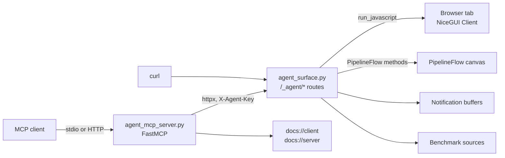

# Agent layer (MCP tools and /_agent routes)

## Overview

The agent layer lets a program drive the Pipeline Editor GUI.
It has two parts.
The GUI app serves 21 HTTP routes under `/_agent/*` (`agent_surface.py`).
A FastMCP server (`agent_mcp_server.py`) wraps those routes as 22 MCP tools and two documentation resources.
An MCP client such as Claude Code, Claude Desktop or a Google ADK agent calls the tools.
A script can call the routes with `curl` instead.
The [helper agent](../helper/README.md) is a ready-made Claude Code project that uses these tools.

## Architecture



`agent_mcp_server.py` is a pure HTTP client of the GUI app.
Each tool sends one request to one route, except `get_documentation`, which reads the docs indexes from disk.
`agent_surface.py` resolves the `client_id` to a NiceGUI `Client`.
Most helpers run JavaScript in that tab with `run_javascript`.
The canvas helpers call `PipelineFlow` methods and read the canvas copy in `agent_nodes` and `agent_edges`.
The MCP server needs the GUI app running.
The MCP server runs over stdio by default.
With `--transport http` it listens on `--host` (default `127.0.0.1`) and `--port` (default `8091`).
The GUI app itself listens on `GUI_APP_PORT` (default `8080`).

## Components

| Component | Description | Reference |
|---|---|---|
| `agent_mcp_server.py` | Defines the FastMCP server, the 22 tools and the two resources. | [GUI reference](../reference/gui/index.md) |
| `agent_surface.py` | Defines the 21 `/_agent/*` routes, the key check, the notification buffer and the browser helpers. | [GUI reference](../reference/gui/index.md) |
| `components/pipeline_flow.py` | Provides the canvas that the graph tools read and edit. | [GUI reference](../reference/gui/index.md) |
| `app.py` | Imports `agent_surface` and shows the client id in the page corner. | [GUI reference](../reference/gui/index.md) |

The per-tool pages are listed in the [GUI reference](../reference/gui/index.md).

## Flow

1. The MCP client reads `docs://client` and `docs://server`, or calls `get_documentation`.
2. The client calls `list_sessions` and picks a `client_id`.
3. The client calls a tool with the `client_id`.
4. The tool sends the request to the matching route with the `X-Agent-Key` header when a key is set.
5. The route checks the key and resolves the tab.
6. The helper runs JavaScript in the tab or calls the canvas.
7. The route returns a dict with `ok` set to true or false.
8. The client reads the result and repeats from step 3.

### Client id

`GET /_agent/sessions` lists the connected tabs as `{'client_id', 'has_socket_connection'}`.
Every browser tab has its own id.
The page also shows the id in the bottom-left corner, with a button that copies it.
Every tool except `get_documentation`, `list_sessions` and `get_source_frame` takes a `client_id`.

### Graph scope

The graph tools act on the outer canvas of the tab.
While an ROI subflow dialog is open, they act on the subflow graph instead.
The subflow wiring is locked, so `connect_nodes` and `delete_edge` return `subflow_locked`.
The node fields stay editable through `open_node`.

### Tools

| Tool | Route | Purpose |
|---|---|---|
| `get_documentation` | none | Returns the docs indexes as `{'client': {...}, 'server': {...}}`. |
| `list_sessions` | `GET /_agent/sessions` | Lists connected tabs. |
| `get_state` | `GET /_agent/state` | Reads dialog state, drawer state, buttons, toggles, fields, tabs and `sources`. |
| `get_graph` | `GET /_agent/graph` | Reads `nodes` and `edges`. |
| `get_text` | `GET /_agent/get_text` | Reads the text of the one element that contains a substring. |
| `get_notifications` | `GET /_agent/notifications` | Reads toasts newer than `since_id`. |
| `get_tooltip` | `POST /_agent/tooltip` | Reads the tooltip of a labeled element. |
| `hover` | `POST /_agent/hover` | Starts or stops a hover (`action` is `enter` or `leave`). |
| `click` | `POST /_agent/click` | Clicks an element by visible text, icon name, `alt` or `aria-label`. |
| `set_field` | `POST /_agent/set_field` | Sets a toggle, checkbox, input or dropdown by label. |
| `toggle_dropdown` | `POST /_agent/toggle_dropdown` | Opens or closes a dropdown. |
| `read_dropdown_options` | `POST /_agent/read_dropdown_options` | Reads the options of an open dropdown. |
| `add_node` | `POST /_agent/add_node` | Adds a node by its palette label. |
| `position_node` | `POST /_agent/position_node` | Moves a node to `frac_x`, `frac_y` of the canvas pane. |
| `connect_nodes` | `POST /_agent/connect_nodes` | Adds an edge. |
| `open_node` | `POST /_agent/open_node` | Opens the node dialog by double-click. |
| `delete_node` | `POST /_agent/delete_node` | Deletes a node. A locked node returns `node_locked`. |
| `delete_edge` | `POST /_agent/delete_edge` | Deletes an edge. |
| `screenshot` | `GET /_agent/screenshot` | Returns a JPEG of the page (`max_width` 1280, `quality` 0.5). |
| `get_source_frame` | `GET /_agent/source_frame` | Returns the latest frame of a Benchmarking source as a JPEG. |
| `highlight` | `POST /_agent/highlight` | Draws a callout over an element. |
| `clear_highlight` | `POST /_agent/clear_highlight` | Removes one highlight by `id`, or all. |

`get_documentation` takes `which` (`client`, `server` or `all`, default `all`).
`set_field` and the dropdown tools take an optional `scope_id`.
`scope_id` restricts the match to the element with that `data-agent-id`.
It is required when several widgets render the same label, for example two sources added from the same file.
The `highlight` kinds are `button`, `tab`, `toggle`, `field`, `node`, `edge`, `dialog`, `text`, `palette`, `auto` and `pointer`.
`kind='edge'` takes `source_id` and `target_id`.
`kind='palette'` matches the exact palette label, as `add_node` does.
`screenshot` and `get_source_frame` return an image, or the error dict on failure.

### Resources

| URI | Name | Content |
|---|---|---|
| `docs://client` | `client-docs` | `client/docs/README.md`, the client docs index. |
| `docs://server` | `server-docs` | `server/docs/README.md`, the server docs index. |

An unreadable file returns a `(failed to read <path>: <error>)` string.

### Notification buffer

`agent_surface.py` wraps `ui.notify`.
Each toast raised inside a client context is stored in a buffer for that client id.
Each buffer keeps the newest 200 toasts (`AGENT_NOTIFICATION_BUFFER_SIZE`).
Each record has `id`, `ts`, `message`, `type` and `position`.
The `id` comes from one counter shared by all clients and increases with each toast.
A client polls with `since_id` set to the last `id` it saw.
A new `since_id` of 0 returns the whole buffer.

### Error codes

A failed helper returns `{'ok': False, 'error': <code>, ...}`.
The HTTP layer uses status codes for access errors.

| HTTP status | Trigger |
|---|---|
| 401 | `GUI_AGENT_API_KEY` is set and the `X-Agent-Key` header differs. |
| 404 | No connected client has the `client_id`. |

| Error code | Returned by | Meaning |
|---|---|---|
| `not_found` | click, hover, get_text, get_tooltip, set_field, toggle_dropdown, read_dropdown_options, get_source_frame | No element or source matches. |
| `ambiguous` | click, hover, get_text, get_tooltip, set_field, dropdown tools | Several elements match equally well. Use a longer label or `scope_id`. |
| `scope_not_found` | set_field, dropdown tools | No element has the `scope_id`. |
| `disabled` | set_field, dropdown tools | The target control is disabled. |
| `option_not_found` | set_field | No dropdown option matches. The result lists `rendered_options_seen`. |
| `not_a_dropdown` | toggle_dropdown | The field is not a dropdown. |
| `qselect_ref_not_found` | toggle_dropdown | The dropdown component is not registered. |
| `not_open` | read_dropdown_options | The dropdown is closed. |
| `unknown_label` | add_node | The palette label is unknown. The result lists `known_labels`. |
| `category_not_found`, `leaf_not_found_after_expand`, `node_never_appeared` | add_node | The palette click did not add a node. |
| `out_of_range` | position_node | `frac_x` or `frac_y` is outside 0.0 to 1.0. |
| `canvas_not_found` | graph tools, highlight | The tab has no canvas. |
| `node_not_found` | graph tools | The node id is not on the graph. |
| `node_not_rendered`, `node_disappeared` | position_node, open_node | The node is not on screen. |
| `subflow_locked` | connect_nodes | The ROI subflow wiring is fixed. |
| `edge_never_appeared` | connect_nodes | The edge did not appear. |
| `edge_not_found`, `edge_still_present` | delete_edge, highlight | The edge is missing, or deletion failed. |
| `node_locked`, `node_still_present` | delete_node | The node is locked, or deletion failed. |
| `dialog_never_opened` | open_node | The double-click opened no dialog. |
| `missing_source_or_target` | highlight | `kind='edge'` lacks `source_id` or `target_id`. |
| `html2canvas_not_loaded`, `malformed_data_url` | screenshot | The capture failed in the browser. |
| `no_frames_yet` | get_source_frame | The source has no saved frame. |
| `js_exception`, `js_error` | most browser helpers | The browser call raised or returned a non-dict. |

`agent_mcp_server.py` raises `httpx.HTTPStatusError` on a non-2xx response.

## Configuration

| Setting | Default | Effect |
|---|---|---|
| `GUI_APP_BASE_URL` | `http://127.0.0.1:8080` | Base URL of the GUI app for the MCP server. Match it to `GUI_APP_PORT`. |
| `GUI_AGENT_API_KEY` | empty | The MCP server sends it as `X-Agent-Key`. The GUI app requires it when set. |
| `GUI_APP_PORT` | `8080` | Port of the GUI app and its `/_agent/*` routes. |
| `--transport` | `stdio` | Selects `stdio` or `http` for the MCP server. |
| `--host` | `127.0.0.1` | Sets the HTTP transport host. |
| `--port` | `8091` | Sets the HTTP transport port of the MCP server. |

## Constraints

- The `X-Agent-Key` check is off when `GUI_AGENT_API_KEY` is empty in the GUI app.
- The MCP server sets a 30 s timeout on every call to the GUI app.
- Browser helpers wait 5 s for a JavaScript result, 3 s for a dialog count and 15 s for a screenshot.
- While a modal dialog is open, lookups search inside it first.
- A dialog counts as open only while Quasar's `q-dialog--modal` class is present.
- `screenshot` needs `html2canvas` loaded in the page.
- `get_source_frame` takes no `client_id`, because a source is server-side state.
- The `sources` field of `get_state` holds the metrics of every Benchmarking source, independent of the tab.

## Quick Example

Start the GUI, list the tabs, then read the graph of one tab.

```bash
curl -s http://127.0.0.1:8080/_agent/sessions
curl -s "http://127.0.0.1:8080/_agent/graph?client_id=<client_id>"
curl -s -X POST http://127.0.0.1:8080/_agent/click \
  -H 'Content-Type: application/json' \
  -d '{"client_id": "<client_id>", "text": "Benchmarking"}'
```

Add `-H "X-Agent-Key: $GUI_AGENT_API_KEY"` when a key is set.
Run the MCP server for a network client:

```bash
python3 agent_mcp_server.py --transport http --port 8091
```

## Related

- [pipeline-editor.md](pipeline-editor.md) describes the canvas and nodes these tools edit.
- [benchmarking.md](benchmarking.md) describes the tab these tools also drive.
- [Helper agent](../helper/README.md) runs these tools for you.
- [Runbooks](../helper/agent/runbook/index.md) show call-by-call walkthroughs.

## Source files

- `client/ui/gui/agent_mcp_server.py`
- `client/ui/gui/agent_surface.py`
- `client/ui/gui/app.py`
- `client/ui/gui/components/pipeline_flow.py`
