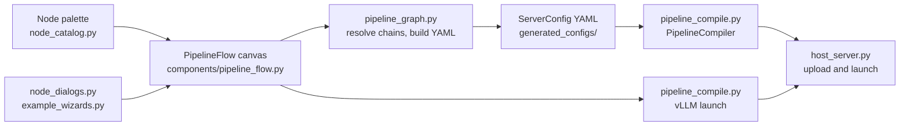

# Pipeline Editor

## Overview

The Pipeline Editor is the first tab of the No-Code Pipeline Editor GUI (`client/ui/gui/app.py`).
It lets a user draw an inference pipeline as a node graph instead of writing YAML.
The GUI turns the graph into a server config, compiles it, uploads the specs to the host server and launches the pipelines.
A (V/L)LM node skips the compile step and launches vLLM servers instead.
Users who want to drive the same canvas from an agent use the [agent layer](mcp-endpoints.md).

## Architecture



`app.py` builds the page and starts the server.
The listen address comes from `GUI_APP_HOST` (default `0.0.0.0`) and `GUI_APP_PORT` (default `8080`).
`HOST_SERVER_URL` and `HOST_SERVER_API_KEY` locate `host_server.py`.
The GUI reads `SDK_ROOT` from `GET /api/v1/sdk-root` on the host server when the variable is unset.
The page has a header with the tabs `Pipeline Editor` and `Benchmarking` and a `Debug` switch.
A left drawer holds the searchable node palette (`PALETTE_TREE`) and the Global Settings (`OpenCL`, `SIMD decode`, `restart_interval`).
The main area holds the `PipelineFlow` canvas, a Vue Flow widget.
Four buttons sit on the canvas: `Load Config`, `Generate Config YAML`, `Compile and Launch Pipeline` and `Force Stop All`.
The canvas state lives in `core.app.state.current_graph` and survives page loads.

## Components

| Component | Description | Reference |
|---|---|---|
| `app.py` | Builds the page, the palette handlers and the save, load and force-stop dialogs. | [GUI reference](../reference/gui/index.md) |
| `node_catalog.py` | Defines `PALETTE_TREE`, `NODE_CATALOG`, the default node data and the demo canvas. | [GUI reference](../reference/gui/index.md) |
| `components/pipeline_flow.py` | Wraps the Vue Flow canvas as `PipelineFlow`. | [GUI reference](../reference/gui/index.md) |
| `pipeline_graph.py` | Resolves canvas chains, builds and validates the config YAML, rebuilds a canvas from a config. | [GUI reference](../reference/gui/index.md) |
| `pipeline_compile.py` | Calls the host server and runs the Compile and Launch flow. | [GUI reference](../reference/gui/index.md) |
| `node_dialogs.py` | Provides the node edit dialogs and the ROI sub-canvas dialog. | [GUI reference](../reference/gui/index.md) |
| `example_wizards.py` | Provides the demo wizards that generate ready-made graphs. | [GUI reference](../reference/gui/index.md) |

## Node kinds

The palette offers six nodes under `Nodes`.
Each node stores its settings in `data['kind']`.

| Palette label | `kind` | Description |
|---|---|---|
| `Input` | `input` | Serves a gRPC pipeline on `port` (default 50060) with a `pipeline_id`. |
| `Vision` | `vision` | Runs one compiled `.axnet` model on a device (default device 0, 4 cores). |
| `Filter` | `filter` | Filters detections by `classes`, score, size or `top_k`. |
| `ROI` | `roi` | Runs a second model on each detected region. Mode is `simple` or `conditional`. |
| `(V/L)LM` | `vllm_vlm` | Launches vLLM servers for a text LLM or a VLM (`is_vlm`). |
| `Sink` | `sink` | Ends a pipeline chain. |

A vision pipeline is a chain Input, then Vision, Filter or ROI hops, then Sink.
The graph resolver follows each chain backwards from its Sink to an Input.
A (V/L)LM node forms its own Input, (V/L)LM, Sink row.
The graph resolver ignores Inputs and Sinks that connect to a (V/L)LM node.
A Track node is rejected in a chain.
The ROI node expands to `roi_iter`, model A, an optional condition with model B, `roi_collect` and `loop_guard`.
The canvas allows at most one link per handle direction.
Dragging a new link onto a linked handle replaces the old link.

## Flow

1. The user adds nodes with a click on a palette leaf.
2. The canvas places new nodes on a grid of 5 columns, starting at (50, 250).
3. The user double-clicks a node to edit its fields in a dialog.
4. `Generate Config YAML` builds the config YAML and validates the result with `ServerConfig`.
5. A validation error appears as a toast. The button tooltip shows the reason while the graph is invalid.
6. The save dialog writes the YAML into `generated_configs/`.
7. `Compile and Launch Pipeline` starts the compile and launch flow.
8. For connected (V/L)LM nodes, the flow checks device health and calls `POST /api/v1/vllm/launch` once per device.
9. The flow compiles the YAML locally with `PipelineCompiler` into specs under `compiled_specs/<doc_id>`.
10. The flow shuts down earlier instances of the same pipeline ids with `POST /api/v1/pipelines/shutdown`.
11. For nets with an `axnet` path, the flow provisions every referenced prebuilt model and recompiles with the resolved paths.
12. In the same provisioning branch, the flow applies each `meta_key_override` with `POST /api/v1/prebuilt-models/patch-meta-key`.
13. The flow checks device health and stops when a device is faulty.
14. The flow uploads each spec with `POST /api/v1/pipeline-spec`.
15. The flow launches each pipeline with `POST /api/v1/pipelines/launch` and a 200 s timeout.
16. The flow points the Benchmarking inputs at the new endpoints.

The server side of these calls is described in [host-server.md](../../../server/docs/host-server/host-server.md), [grpc.md](../../../server/docs/interfaces/grpc.md) and [serving.md](../../../server/docs/vllm/serving.md).
The config schema and compilers are described in [compiler.md](../client/compiler.md).

### Canvas interactions

| Action | Effect |
|---|---|
| Click a node | Selects the node. |
| Ctrl/Cmd+click | Adds a node to the selection. |
| Shift+drag on empty space | Box-selects nodes. |
| Ctrl/Cmd+C, then click, then Ctrl/Cmd+V | Copies the selection with its inner links and pastes it at the clicked position. |
| Right-click a node | Opens a `Delete node` context menu. The menu deletes only that node. |
| Backspace or Delete | Removes the selection. |
| Ctrl/Cmd+Z | Undoes the last change. The undo stack keeps 20 snapshots. |
| `Debug` switch | Records browser events and writes `debug_recordings/session_<unix time>.json` when switched off. |

### Advanced per-node settings

| Setting | Nodes | Effect |
|---|---|---|
| `taskset_cpus` | Input | Pins the pipeline to a CPU list. The launch request sends it to the host server. |
| `membind` | Input | Binds memory to a NUMA node. The launch request sends it to the host server. |
| `meta_key_override` | Vision, ROI models | Renames the postprocess output key of a net. |
| `queue_depth`, `queue_timeout_ms` | Vision, ROI models | Sets the per-model queue (defaults 64 and 2000 ms). |
| `imdecode_threads`, `imdecode_queue_depth`, `imdecode_queue_timeout_ms` | Input | Tunes image decoding (defaults 4, 32 and 20000 ms). |

The config builder raises a `ValueError` when two nets produce the same meta key.
The Filter and ROI dialogs detect the upstream meta key and read it through `GET /api/v1/models/{model_name}/meta-key`.
A device health check marks failed devices in `core.app.state.unhealthy_devices`.
The Compile button stays disabled while a vision node uses a failed device.

### Examples

The palette subtree `Examples` generates ready-made graphs through wizards.
The wizards replace the canvas with the generated graph.

| Entry | Result |
|---|---|
| `Isovision Demo` | One Input, Model, Sink pipeline per group of healthy devices. |
| `Two-Stage Cascade` | A primary model and a secondary model on an ROI chain. |
| `Three-Stage Conditional Cascade` | The cascade plus a gated third model. |
| `Iso-VLM/LLM-Demo` | One Input, (V/L)LM, Sink row per configuration. |

The runbooks in [runbook/index.md](../helper/agent/runbook/index.md) walk through each example call by call.

## Configuration

| Setting | Default | Effect |
|---|---|---|
| `GUI_APP_HOST` | `0.0.0.0` | Sets the listen host. |
| `GUI_APP_PORT` | `8080` | Sets the listen port. |
| `HOST_SERVER_URL` | empty | Locates `host_server.py`. Compile and launch fail when it is empty. |
| `HOST_SERVER_API_KEY` | empty | Sent as the `X-API-Key` header. |
| `SDK_ROOT` | from `GET /api/v1/sdk-root` | Resolves `${SDK_ROOT}` in model paths. |
| `OpenCL` | on | Sets `use_axinference_net_opencl` in the config `global` section. |
| `SIMD decode` | on | Sets `use_simd_decode`. Off uses OpenCV. |
| `restart_interval` | 0 | Sets the restart interval in seconds. 0 disables it. |

## Constraints

- Only one compile or launch runs at a time (`core.app.state.compile_in_progress`).
- Each pipeline needs a distinct `pipeline_id` and a distinct Input `port`.
- Net names and predicate names must be unique across all pipelines.
- All Input nodes must agree on `watchdog_timeout_ms` and `result_queue_depth`.
- The Compile button needs a generated config or a connected (V/L)LM node.
- `Force Stop All` signals every `axinferencenet_grpc` process on the host after a confirmation dialog.
- The GUI starts without a reachable host server, but model lists stay empty and launch fails.

## Quick Example

Start the GUI against a host server and open the page.

```bash
HOST_SERVER_URL=http://localhost:8000 HOST_SERVER_API_KEY=<key> python3 app.py
```

Open `http://localhost:8080`, double-click the Vision node, choose a model, then click `Generate Config YAML`, `Save` and `Compile and Launch Pipeline`.
See [client/QUICKSTART.md](../../QUICKSTART.md) for the full setup.

## Related

- [benchmarking.md](benchmarking.md) benchmarks the launched pipeline.
- [mcp-endpoints.md](mcp-endpoints.md) drives this canvas from an agent.
- [client.md](../client/client.md) describes `AxVisionClient`, `AxLlmClient` and `AxVlmClient`.
- [compiler.md](../client/compiler.md) describes `ServerConfig` and `PipelineCompiler`.
- [Helper agent](../helper/README.md) drives the GUI for you.

## Source files

- `client/ui/gui/app.py`
- `client/ui/gui/node_catalog.py`
- `client/ui/gui/pipeline_graph.py`
- `client/ui/gui/pipeline_compile.py`
- `client/ui/gui/node_dialogs.py`
- `client/ui/gui/example_wizards.py`
- `client/ui/gui/components/pipeline_flow.py`
- `client/ui/gui/components/pipeline_flow.js`
