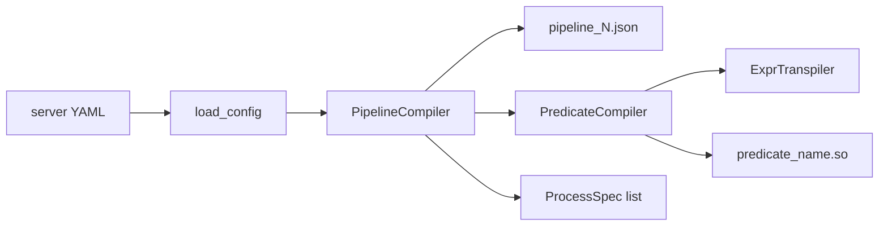

# Compiler reference

## Overview

The `client/compiler` package turns a server YAML config into the files that launch pipeline servers. `pipeline.py` writes one JSON spec per pipeline. `predicate.py` turns expression predicates into C++ and builds them as shared libraries. The concept page is [compiler](../../client/compiler.md).

## Architecture



## Pages

| Page | Kind | Summary |
|---|---|---|
| [PipelineCompiler](PipelineCompiler.md) | class | Compiles a `ServerConfig` into pipeline JSON and process specs. |
| [PipelineCompiler.compile_all](PipelineCompiler.compile_all.md) | function | Compiles every pipeline in config order. |
| [ProcessSpec](ProcessSpec.md) | class | Launch description for one pipeline process. |
| [main](main.md) | function | Command-line entry point of `pipeline.py`. |
| [ExprTranspiler](ExprTranspiler.md) | class | Translates an expression predicate to C++. |
| [ExprTranspiler.generate_cpp](ExprTranspiler.generate_cpp.md) | function | Returns the C++ source of the predicate. |
| [PredicateCompiler](PredicateCompiler.md) | class | Builds an expression predicate into a shared library. |
| [PredicateCompiler.compile](PredicateCompiler.compile.md) | function | Transpiles and builds the `.so` file. |

## Quick Example

```bash
python client/compiler/pipeline.py server.yaml out/
```

The command prints one `id`, `port` and JSON path per pipeline, separated by tabs.
