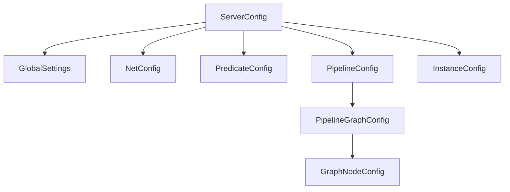

# Configs reference

## Overview

`client/configs/utils/config_schema.py` defines the pydantic schema of the server YAML config and the `load_config` function that reads it. The compiler and the GUI both use it. The concept pages are [compiler](../../client/compiler.md) and [client](../../client/client.md).

## Architecture



`ServerConfig` validates references across sections. Nodes must name existing nets and predicates. Ports must be unique.

## Pages

| Page | Kind | Summary |
|---|---|---|
| [ServerConfig](ServerConfig.md) | model | Root of the server YAML config. |
| [GlobalSettings](GlobalSettings.md) | model | The `global:` section. |
| [NetConfig](NetConfig.md) | model | A named model entry of `nets:`. |
| [PredicateConfig](PredicateConfig.md) | model | Union of the three predicate models. |
| [BuiltinPredicateConfig](BuiltinPredicateConfig.md) | model | Predicate from the server's built-in set. |
| [ExprPredicateConfig](ExprPredicateConfig.md) | model | Predicate defined by a Python expression. |
| [PluginPredicateConfig](PluginPredicateConfig.md) | model | Predicate loaded from a shared library. |
| [PipelineConfig](PipelineConfig.md) | model | One graph pipeline entry. |
| [PipelineGraphConfig](PipelineGraphConfig.md) | model | Node graph with structure checks. |
| [GraphNodeConfig](GraphNodeConfig.md) | model | One node of a pipeline graph. |
| [InstanceConfig](InstanceConfig.md) | model | One single-net instance entry. |
| [InstanceConfig.to_env_vars](InstanceConfig.to_env_vars.md) | function | Builds the instance container environment. |
| [load_config](load_config.md) | function | Loads and validates a YAML config file. |

## Quick Example

```python
import sys

sys.path.insert(0, 'client/configs/utils')

from config_schema import load_config

cfg = load_config('server.yaml')
for p in cfg.pipelines:
    print(p.id, p.port)
```
