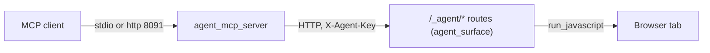

# GUI reference

## Overview

The GUI is the No-Code Pipeline Editor, a NiceGUI app that listens on `GUI_APP_PORT` (default 8080). This area documents its agent layer: the `/_agent/*` HTTP routes in `agent_surface.py` and the FastMCP server in `agent_mcp_server.py` that exposes them as 22 MCP tools. See [Pipeline Editor](../../gui/pipeline-editor.md), [Benchmarking](../../gui/benchmarking.md) and [MCP endpoints](../../gui/mcp-endpoints.md).

## Architecture



## Pages

### Modules and concepts

| Page | Kind | Summary |
|---|---|---|
| [agent_mcp_server](agent_mcp_server.md) | module | The FastMCP server, its options and environment. |
| [agent_surface](agent_surface.md) | module | Public API of the route and helper module. |
| [Routes overview](agent-routes.md) | route | All 21 `/_agent/*` routes and their tools. |
| [MCP resources](mcp-resources.md) | resource | The `docs://client` and `docs://server` resources. |
| [Notification buffer](notification-buffer.md) | class | The per-tab toast buffer of 200 records. |
| [Error codes](error-codes.md) | reference | HTTP statuses and `ok: false` codes. |
| [Sessions and client_id](sessions-and-client-id.md) | reference | How tabs are listed and addressed. |

### mcp/

| Page | Kind | Summary |
|---|---|---|
| [get_documentation](mcp/get_documentation.md) | tool | Returns the client and server documentation indexes as text. |
| [list_sessions](mcp/list_sessions.md) | tool | Lists the connected browser tabs and their `client_id` values. |
| [get_state](mcp/get_state.md) | tool | Reads the visible UI state of one browser tab. |
| [get_graph](mcp/get_graph.md) | tool | Reads the canvas graph of one browser tab. |
| [get_text](mcp/get_text.md) | tool | Reads the text of the one visible element whose own text contains a substring. |
| [get_notifications](mcp/get_notifications.md) | tool | Reads the toast notifications raised in one tab, newer than a given id. |
| [get_tooltip](mcp/get_tooltip.md) | tool | Reads the tooltip shown when hovering a labeled element. |
| [hover](mcp/hover.md) | tool | Starts or stops hovering an element with synthetic mouse events. |
| [click](mcp/click.md) | tool | Clicks a button, tab, toggle, radio, labeled image or palette row by its visible text. |
| [set_field](mcp/set_field.md) | tool | Sets a toggle, checkbox, text or number field, or dropdown selection by label. |
| [toggle_dropdown](mcp/toggle_dropdown.md) | tool | Opens a dropdown when it is closed and closes it when it is open. |
| [read_dropdown_options](mcp/read_dropdown_options.md) | tool | Reads every option of a dropdown whose menu is already open. |
| [add_node](mcp/add_node.md) | tool | Adds a node to the canvas by clicking its leaf in the node palette. |
| [position_node](mcp/position_node.md) | tool | Drags a canvas node to a position given as fractions of the canvas pane. |
| [connect_nodes](mcp/connect_nodes.md) | tool | Connects two canvas nodes with an edge. |
| [open_node](mcp/open_node.md) | tool | Opens a canvas node's dialog by double-clicking it. |
| [delete_node](mcp/delete_node.md) | tool | Deletes a canvas node. |
| [delete_edge](mcp/delete_edge.md) | tool | Deletes the edge between two canvas nodes. |
| [screenshot](mcp/screenshot.md) | tool | Captures a JPEG screenshot of a browser tab. |
| [get_source_frame](mcp/get_source_frame.md) | tool | Fetches the newest saved frame of a Benchmarking source as a JPEG. |
| [highlight](mcp/highlight.md) | tool | Draws a visual callout over a live element. |
| [clear_highlight](mcp/clear_highlight.md) | tool | Removes one highlight, or all highlights in a tab. |

## Quick Example

List tabs, then click a button, against the GUI on port 8080.

```bash
curl -s http://127.0.0.1:8080/_agent/sessions
curl -s -X POST http://127.0.0.1:8080/_agent/click \
  -H 'Content-Type: application/json' \
  -d '{"client_id": "<client_id>", "text": "play_arrow"}'
```
