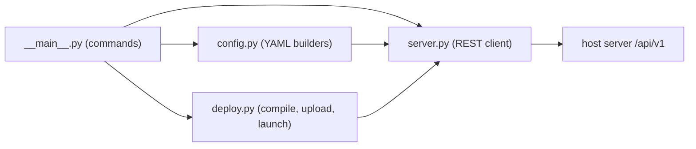

# Helper CLI reference

## Overview

The helper is a Python package under `client/examples/helper/`. Run it with `python -m helper <command>` from `client/examples/`. It drives the host server REST API from the command line: devices, models, config generation, compile, upload, launch, vLLM and power. Each subcommand follows one step of the GUI workflow. Concept page: [Client examples](../../../examples/README.md). Server side: [Host server](../../../../server/docs/host-server/host-server.md).

## Architecture



The environment variables `HOST_SERVER_URL` and `HOST_SERVER_API_KEY` configure every command. Exit code 0 means success, 1 a server error, 2 a usage error.

## Pages

| Page | Kind | Summary |
|---|---|---|
| [python -m helper compile](cli-compile.md) | command | Validates a config YAML and compiles it into pipeline specs. |
| [python -m helper config cascade](cli-config-cascade.md) | command | Writes a config YAML for a detector, filter and per-crop secondary pipeline. |
| [python -m helper config cascade3](cli-config-cascade3.md) | command | Writes a config YAML for a cascade with a conditional tertiary stage. |
| [python -m helper config isovision](cli-config-isovision.md) | command | Writes a config YAML for N independent single-detector pipelines. |
| [python -m helper devices](cli-devices.md) | command | Health-checks devices and prints the healthy device indexes. |
| [python -m helper down](cli-down.md) | command | Stops pipelines named by a compiled directory or by ids. |
| [python -m helper health](cli-health.md) | command | Checks that the host server answers `GET /api/v1/health`. |
| [python -m helper launch](cli-launch.md) | command | Launches the uploaded pipelines and prints their endpoints. |
| [python -m helper media](cli-media.md) | command | Downloads the sample videos into the server tree. |
| [python -m helper models list](cli-models-list.md) | command | Prints the models known to the server, grouped by kind. |
| [python -m helper models provision](cli-models-provision.md) | command | Downloads and compiles prebuilt models on a device. |
| [python -m helper pin](cli-pin.md) | command | Prints the CPU list and NUMA node planned for each group of healthy devices. |
| [python -m helper power](cli-power.md) | command | Reads or sets the power limit of one device. |
| [python -m helper status](cli-status.md) | command | Prints queue statistics of pipelines. |
| [python -m helper stop-all](cli-stop-all.md) | command | Stops every pipeline and vLLM server on the host. |
| [python -m helper up vision](cli-up-vision.md) | command | Compiles, uploads and launches a config in one step. |
| [python -m helper upload](cli-upload.md) | command | Uploads the compiled specs of a directory to the server. |
| [python -m helper vllm down](cli-vllm-down.md) | command | Stops a vLLM instance by name. |
| [python -m helper vllm status](cli-vllm-status.md) | command | Lists the vLLM instances of the server. |
| [python -m helper vllm up](cli-vllm-up.md) | command | Starts a vLLM server for a compiled artifact. |
| [build_parser](build_parser.md) | function | Builds the argparse parser with one subparser per subcommand. |
| [config.axnet_path](config.axnet_path.md) | function | Returns the `${SDK_ROOT}`-relative path of the compiled `.axnet` of a model. |
| [config.cascade](config.cascade.md) | function | Builds the config for a detector, filter and per-crop secondary pipeline, with an optional tertiary stage. |
| [config.isovision](config.isovision.md) | function | Builds the config for N independent single-detector pipelines and returns it as YAML. |
| [deploy.compile_config](deploy.compile_config.md) | function | Validates a config YAML and compiles it into pipeline specs. |
| [deploy.doc_id_for](deploy.doc_id_for.md) | function | Derives a filesystem-safe name for a set of pipelines. |
| [deploy.down](deploy.down.md) | function | Stops each named pipeline and logs whether it was running. |
| [deploy.launch](deploy.launch.md) | function | Launches every uploaded pipeline and returns the endpoints. |
| [deploy.pipeline_ids](deploy.pipeline_ids.md) | function | Resolves pipeline ids from an id string or a compiled directory. |
| [deploy.status](deploy.status.md) | function | Prints queue statistics for each pipeline and reports whether all are healthy. |
| [deploy.upload](deploy.upload.md) | function | Uploads each compiled spec to the server and records its saved path in the manifest. |
| [main](main.md) | function | Runs the helper CLI and maps exceptions to exit codes. |
| [EXIT_OK, EXIT_FAIL, EXIT_USAGE](server.EXIT_CODES.md) | constant | Defines the exit codes 0, 1 and 2. |
| [server.ServerError](server.ServerError.md) | class | Signals an unreachable server or an error reply. |
| [server.UsageError](server.UsageError.md) | class | Signals invalid input or an environment that is not set up. |
| [server.api](server.api.md) | function | Calls an `/api/v1` endpoint with the API key. |
| [server.axdevice_status](server.axdevice_status.md) | function | Returns the axdevice status of a device, including its power limit. |
| [server.check_health](server.check_health.md) | function | Queries the unauthenticated health endpoint. |
| [server.cpu_topology](server.cpu_topology.md) | function | Returns the host CPU and NUMA topology. |
| [server.device_health](server.device_health.md) | function | Health-checks devices on the server. |
| [server.device_indexes](server.device_indexes.md) | function | Returns the sorted indexes of the devices the server reports. |
| [server.device_name](server.device_name.md) | function | Looks up the name of a device. |
| [server.fetch_media](server.fetch_media.md) | function | Downloads the sample videos on the server and waits until the download ends. |
| [server.healthy_devices](server.healthy_devices.md) | function | Health-checks devices and returns the usable ones. |
| [server.list_models](server.list_models.md) | function | Lists the models known to the server. |
| [server.log](server.log.md) | function | Prints a timestamped progress message to stderr. |
| [server.merge_cpu_ranges](server.merge_cpu_ranges.md) | function | Collapses CPU ids into a taskset-style range string. |
| [server.numa_plan](server.numa_plan.md) | function | Gets the server CPU plan for a set of devices. |
| [server.pin_groups](server.pin_groups.md) | function | Plans CPU pinning for groups of devices. |
| [server.provision_model](server.provision_model.md) | function | Downloads and compiles a prebuilt model, optionally patching its meta_key. |
| [server.require_env](server.require_env.md) | function | Reads the server URL and API key from the environment. |
| [server.select_first_healthy](server.select_first_healthy.md) | function | Finds the first healthy device, trying a preferred index first. |
| [server.set_power_limit](server.set_power_limit.md) | function | Sets or clears the power limit of a device. |
| [server.stop_all](server.stop_all.md) | function | Stops every pipeline and vLLM server on the host. |
| [server.vllm_down](server.vllm_down.md) | function | Stops a vLLM instance. |
| [server.vllm_status](server.vllm_status.md) | function | Returns the vLLM instances the server knows about. |
| [server.vllm_up](server.vllm_up.md) | function | Launches a vLLM server for a compiled artifact. |

## Quick Example

```bash
cd client/examples
export HOST_SERVER_URL=http://host:8000 HOST_SERVER_API_KEY=...
python -m helper health
python -m helper config isovision -o configs/iso.yaml
python -m helper up vision configs/iso.yaml
```
