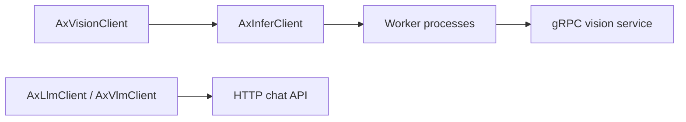

# Inference reference

## Overview
The `client/inference` package holds the Python clients for the inference servers. The gRPC clients send images to the vision service through worker processes and shared memory. The HTTP clients call LLM and VLM servers through an OpenAI-compatible API. See the [client concept page](../../client/client.md).

## Architecture


`from inference import ...` exports `AxInferClient`, `AsyncAxInferClient`, `AxVisionClient` and `AsyncAxVisionClient`. The LLM and VLM clients and `ChatInferResult` come from `inference.llm_vlm`.

## Pages
| Page | Kind | Summary |
|---|---|---|
| [AxInferClient](AxInferClient.md) | class | Blocking base client for cross-process gRPC calls. |
| [AxInferClient.open_stream](AxInferClient.open_stream.md) | function | Opens a callback stream for pipelined calls. |
| [AsyncAxInferClient](AsyncAxInferClient.md) | class | Asyncio twin of `AxInferClient`. |
| [AxVisionClient](AxVisionClient.md) | class | Blocking client for the vision gRPC service. |
| [AxVisionClient.infer](AxVisionClient.infer.md) | function | Runs one encoded image and returns a `FrameResult`. |
| [AsyncAxVisionClient](AsyncAxVisionClient.md) | class | Asyncio twin of `AxVisionClient`. |
| [AsyncAxVisionClient.infer](AsyncAxVisionClient.infer.md) | function | Async twin of `AxVisionClient.infer`. |
| [AxLlmClient](AxLlmClient.md) | class | Blocking HTTP client for a text-only LLM. |
| [AxLlmClient.infer](AxLlmClient.infer.md) | function | Runs a chat completion for a text prompt. |
| [AxLlmClient.count_tokens](AxLlmClient.count_tokens.md) | function | Counts tokens through `/tokenize`. |
| [AsyncAxLlmClient](AsyncAxLlmClient.md) | class | Asyncio twin of `AxLlmClient` with streaming. |
| [AsyncAxLlmClient.infer](AsyncAxLlmClient.infer.md) | function | Async twin of `AxLlmClient.infer`. |
| [AsyncAxLlmClient.infer_stream](AsyncAxLlmClient.infer_stream.md) | function | Yields text chunks as the server generates them. |
| [AsyncAxLlmClient.count_tokens](AsyncAxLlmClient.count_tokens.md) | function | Async twin of `count_tokens`. |
| [AxVlmClient](AxVlmClient.md) | class | Blocking HTTP client for a vision-language model. |
| [AxVlmClient.infer](AxVlmClient.infer.md) | function | Runs a chat completion over images. |
| [AsyncAxVlmClient](AsyncAxVlmClient.md) | class | Asyncio twin of `AxVlmClient` with streaming. |
| [AsyncAxVlmClient.infer](AsyncAxVlmClient.infer.md) | function | Async twin of `AxVlmClient.infer`. |
| [AsyncAxVlmClient.infer_stream](AsyncAxVlmClient.infer_stream.md) | function | Yields text chunks for an image prompt. |
| [ChatInferResult](ChatInferResult.md) | class | Dataclass for one chat completion result. |

## Quick Example
```python
from inference import AxVisionClient

with AxVisionClient(["localhost:50060"]) as client:
    result = client.infer(image_bytes)
```
