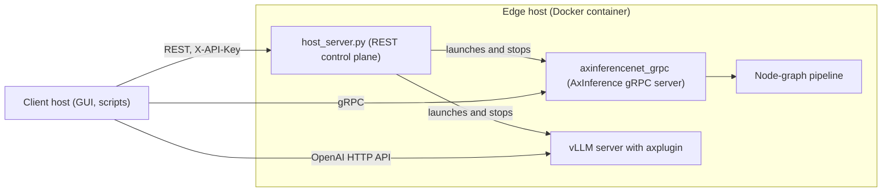

# Server docs

## Overview

The server runs on an edge host with one or more Metis devices attached. The quick start runs the server side in a Docker container.
The server has a REST control plane and two inference paths: a vision gRPC pipeline and a vLLM server for VLM and LLM models.
The client (GUI and Python clients) runs on a separate host and talks to one or more servers over the network.
These docs explain how each part works, which settings a user can change, and which limits apply.
This page is the entry point. Each linked page covers one area.

## Architecture

`deployment/host_server.py` is the control plane. A user starts it to bring a server up.
It launches, stops and reports on the vision gRPC process and on vLLM processes. It also manages devices, models and monitoring.
It carries no inference traffic. The client sends vision requests straight to the gRPC server and VLM or LLM requests straight to vLLM.
The gRPC server builds a node graph from a JSON pipeline spec and runs each decoded frame through it.
The vLLM server loads a compiled model artifact through the `axplugin` platform plugin.

## Components

| Component | Description | Reference |
|---|---|---|
| Host server | REST API that sets up, launches and monitors the server. | [host_server](reference/host_server/index.md) |
| gRPC interface | `AxInference` service that runs a frame through the vision pipeline. | [grpc](reference/grpc/index.md) |
| Proto messages | Request and response messages of the gRPC contract. | [proto](reference/proto/index.md) |
| Pipeline nodes | Node types that make up a vision pipeline graph. | [nodes](reference/nodes/index.md) |
| Image decoding | Decoders that turn encoded images into frames. | [image-decoding](reference/image-decoding/index.md) |
| axplugin | vLLM platform plugin that runs models on the hardware. | [axplugin](reference/axplugin/index.md) |

## Docs pages

| Page | Description |
|---|---|
| [host-server/host-server.md](host-server/host-server.md) | REST control plane: routes, authentication, device, pipeline, vLLM and artifact endpoints. |
| [interfaces/grpc.md](interfaces/grpc.md) | Vision gRPC contract, request lifecycle and server configuration. |
| [vision/pipeline.md](vision/pipeline.md) | Node graph that turns a decoded frame into detections. |
| [vision/image-decoding.md](vision/image-decoding.md) | Image decoding subsystem that feeds the graph. |
| [vllm/serving.md](vllm/serving.md) | How a compiled model artifact loads and serves through vLLM. |
| [vllm/axplugin.md](vllm/axplugin.md) | `axplugin` components that run vLLM on this hardware. |
| [tuning/tuning.md](tuning/tuning.md) | Timeout, queue-depth and thread-count settings in one table. |

## Reference areas

| Area | Content |
|---|---|
| [host_server](reference/host_server/index.md) | One page per REST route. |
| [grpc](reference/grpc/index.md) | gRPC server configuration and request handling. |
| [proto](reference/proto/index.md) | Protobuf messages and the `AxInference` service. |
| [nodes](reference/nodes/index.md) | Pipeline node classes, predicates and the builder. |
| [image-decoding](reference/image-decoding/index.md) | Decoder classes and the decoder factory. |
| [axplugin](reference/axplugin/index.md) | `axplugin` classes and functions. |

## Quick Example

The server quick start covers container setup, a health check and a model launch. See [../QUICKSTART.md](../QUICKSTART.md).
The client quick start is `client/QUICKSTART.md` at the repository root.

## Related

- [Host server](host-server/host-server.md)
- [Server quick start](../QUICKSTART.md)
- [Tuning reference](tuning/tuning.md)

## Source files

- `deployment/host_server.py`
- `server/QUICKSTART.md`
- `server/docs/`
