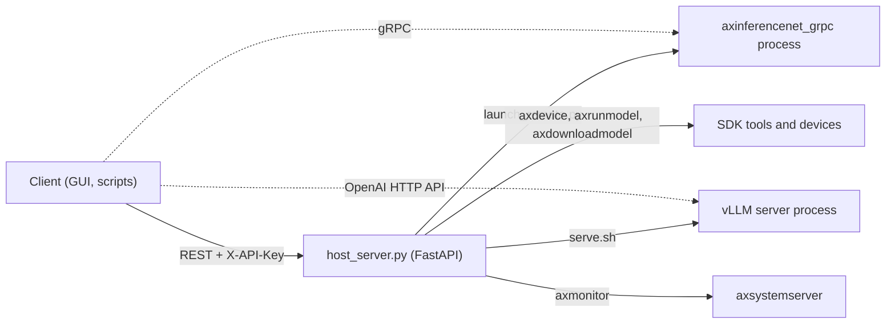

# Host server (REST control plane)

## Overview

`deployment/host_server.py` is a FastAPI app that runs as `host_server:app` under uvicorn. `deployment/setup.sh` starts it in the container or on the host.
It exposes the `/api/v1` REST endpoints that remote clients use to prepare and operate an edge host.
Clients upload pipeline specs and YAML, inspect and maintain Axelera devices, and provision models.
Clients also launch and stop `axinferencenet_grpc` pipelines and vLLM servers, and read AxMonitor telemetry.
The host server does not carry inference traffic. Clients send inference requests directly to the processes it launches.
The GUI and the Python clients call this API. The API key protects every route except `/api/v1/health`.

## Architecture



Each route checks the `X-API-Key` header through the `require_api_key` dependency.
Most routes need `SDK_ROOT` in the environment and return 500 if it is unset or not a directory.
Pipeline processes and vLLM processes sit in separate in-memory tables.
A pipeline shutdown never touches a vLLM instance. Only `POST /api/v1/pipelines/cleanup-all` stops both kinds.
Monitor buffers, launched processes and progress state live in memory. They are lost when the server restarts.
Synchronous routes wait for the underlying SDK tool and return its result. Long jobs have an asynchronous start route and a status route.

## Components

| Component | Description | Reference |
|---|---|---|
| Health and server | Liveness check, SDK root, and restart of the host server process. | [host_server reference](../reference/host_server/index.md) |
| Uploads | Stores YAML files and pipeline spec JSON on the host. | [host_server reference](../reference/host_server/index.md) |
| Models | Lists compiled and prebuilt models, reads and patches meta keys, downloads models. | [host_server reference](../reference/host_server/index.md) |
| Devices | Lists devices, runs `axdevice` maintenance, health checks, throughput tests and CPU planning. | [host_server reference](../reference/host_server/index.md) |
| Monitor | Reads AxMonitor stats, restarts `axsystemserver`, and manages sampling workers. | [host_server reference](../reference/host_server/index.md) |
| Vision pipelines | Launches, stops and inspects `axinferencenet_grpc` processes. | [host_server reference](../reference/host_server/index.md) |
| vLLM | Lists artifacts and launches, stops and reports vLLM servers. | [host_server reference](../reference/host_server/index.md) |
| Benchmark media | Fetches benchmark media files onto the host. | [host_server reference](../reference/host_server/index.md) |

## Routes

All routes live under `/api/v1`. All routes need `X-API-Key` except `GET /health`.

| Route | Description |
|---|---|
| `GET /health` | Returns `{"status": "ok"}`. Needs no key. |
| `GET /sdk-root` | Returns the configured `SDK_ROOT`. |
| `POST /server/restart` | Spawns a watchdog that relaunches uvicorn after 8 s. The process exits about 1.5 s after the response. |
| `POST /yaml` | Stores an uploaded `.yaml` or `.yml` file in `YAML_UPLOAD_DIR`. The content must parse as YAML. |
| `POST /pipeline-spec` | Stores spec JSON at `SDK_ROOT/pipeline_specs/<pipeline_id>/<filename>`. The content must be valid JSON. |
| `GET /models` | Lists vision models (`build/<name>/<name>.axnet`) and VLM models under the SDK root. |
| `GET /models/{name}/meta-key` | Reads the meta key from the YAML under `SDK_ROOT/ax_models` that declares the model name. |
| `GET /prebuilt-models` | Lists the models that `axdownloadmodel` can fetch. The result is cached for 600 s. |
| `POST /prebuilt-models/download` | Downloads a model and generates and smoke-tests its `.axnet`. |
| `POST /prebuilt-models/patch-meta-key` | Rewrites `meta_key` values in a provisioned `.axnet` in place. |
| `GET /devices` | Lists the Metis devices. The result is cached for 20 s. |
| `GET /devices/{device_id}/axdevice` | Returns the device `axdevice -v` line and its parsed power limit. |
| `POST /devices/{device_id}/axdevice` | Runs refresh, firmware reload and/or sets the power limit. |
| `POST /devices/health` | Runs a health check on the devices in the body, or on all devices. |
| `POST /devices/health/all` | Runs a health check on all devices. |
| `POST /devices/health/{index}` | Runs a health check on one device. |
| `POST /devices/health/all/start` | Starts a background health check of all devices. |
| `GET /devices/health/status` | Returns the progress of the background health check. |
| `POST /devices/throughput` | Measures frame throughput on the listed devices. |
| `GET /devices/numa_plan` | Plans CPU pinning per device from the NUMA layout. |
| `GET /devices/cpu_topology` | Reports the CPU topology per NUMA node. |
| `GET /monitor/stats` | Returns AxMonitor statistics for all devices. The result is cached for 1 s. |
| `POST /monitor/restart` | Runs `service axsystemserver restart` and clears the stats cache. |
| `POST /monitor/workers/{device_index}/start` | Starts buffering samples for a device, or updates its interval. |
| `POST /monitor/workers/{device_index}/stop` | Stops the worker and discards its samples. |
| `GET /monitor/workers` | Lists the active workers. |
| `GET /monitor/workers/{device_index}/samples` | Returns buffered samples. |
| `POST /pipelines/launch` | Starts `axinferencenet_grpc` for a stored spec and waits for its port. |
| `GET /pipelines/{pipeline_id}/queue-stats` | Returns the last `STATS_JSON` line from the pipeline log. |
| `POST /pipelines/shutdown` | Stops one tracked pipeline. |
| `POST /pipelines/cleanup-all` | Stops every `axinferencenet_grpc` process on the host and every tracked vLLM instance. |
| `GET /vllm/artifacts` | Lists `SDK_ROOT/build/*/axscript` directories. |
| `POST /vllm/launch` | Runs `serve.sh` and waits up to 180 s for the port. |
| `POST /vllm/shutdown` | Stops one tracked vLLM instance. |
| `GET /vllm/status` | Lists tracked vLLM instances and whether each runs. |
| `POST /benchmark-media/fetch` | Starts a background fetch of benchmark media. |
| `GET /benchmark-media/status` | Returns the fetch progress. |

## Flow

1. The client sends a request with the `X-API-Key` header.
2. `require_api_key` compares the header with `DEPLOYMENT_API_KEY`.
3. The route resolves `SDK_ROOT` and validates the request body.
4. The client uploads a pipeline spec with `POST /pipeline-spec`.
5. The client launches the pipeline with `POST /pipelines/launch`. The server shuts down any process tracked under the same `pipeline_id` first.
6. `launch_remote.launch_one_with_retry` starts `axinferencenet_grpc` and waits until its port opens.
7. The client sends inference requests straight to the gRPC port.
8. The client reads load with `GET /pipelines/{pipeline_id}/queue-stats` and stops the process with `POST /pipelines/shutdown`.

A vLLM launch follows the same pattern with `POST /vllm/launch`. The server exports `MODEL`, `PORT`, `DEVICE`, `THINKING`, `TEMPERATURE`, `AXELERA_PYTHON` and `PYTHONPATH`, then runs `serve.sh`.
Output goes to `<VLLM_LOG_DIR>/<name>.log`. The response includes the `context_length` read from `vlm.json` or `pipeline.json`.

## Configuration

The server reads a `.env` file through `load_dotenv()` and then the process environment.

| Variable | Default | Effect |
|---|---|---|
| `DEPLOYMENT_API_KEY` | none | Expected `X-API-Key` value. Protected routes return 500 if it is unset. |
| `SDK_ROOT` | none | SDK directory. Most routes return 500 if it is unset. |
| `SDK_VENV` | `venv` | Name of the virtual environment under `SDK_ROOT` that holds the SDK tools. |
| `YAML_UPLOAD_DIR` | `deployment/uploaded_yaml` | Directory for `POST /yaml`. |
| `AXINFERENCENET_BIN_PATH` | `server/build/axinferencenet_grpc` | Binary that `POST /pipelines/launch` runs. |
| `BIND_HOST` | `0.0.0.0` | Host that the restart watchdog passes to uvicorn. |
| `BIND_PORT` | `8088` | Port that the restart watchdog passes to uvicorn. |
| `VLLM_AXELERA_DIR` | `server/vllm/axelera` | Directory that holds `scripts/serve.sh`. |
| `VLLM_VENV_PYTHON` | `.venv-vllm/bin/python3` | Python interpreter exported as `AXELERA_PYTHON`. |
| `VLLM_LOG_DIR` | `deployment/vllm_logs` | Directory for vLLM logs. |
| `MONITOR_SERVER_ADDRESS` | `127.0.0.1:5555` | Address that `axmonitor` connects to. |
| `MONITOR_WORKER_MAX_DEVICES` | `30` | Maximum number of monitor workers. |
| `MONITOR_WORKER_MAX_SAMPLES` | `50000` | Maximum samples kept per device. |
| `MONITOR_WORKER_MIN_INTERVAL_S` | `1.0` | Smallest sampling interval. Smaller requests are raised to this value. |
| `MONITOR_WORKER_DEFAULT_INTERVAL_S` | `1.0` | Sampling interval when the request gives none. |
| `MONITOR_RECORDER_ROTATE_S` | `600.0` | Seconds before the recorder process is replaced. |
| `HEALTH_CHECK_MODEL_DIR` | `/tmp/host_server_device_health_check` | Directory for the health check model files. |

## Constraints

- A missing `DEPLOYMENT_API_KEY` returns 500. A missing or wrong `X-API-Key` returns 401.
- `pipeline_id` and vLLM `name` must be 1 to 100 characters of letters, digits, `_` or `-`.
- `spec_path` for a launch must lie under `SDK_ROOT/pipeline_specs`. The route returns 400 otherwise and 404 if the file is missing.
- A pipeline launch returns 500 if the binary is missing and 502 if the process does not listen.
- A vLLM launch returns 400 for a missing artifact and 500 for a missing `serve.sh` or vLLM venv. It returns 502 if the server exits or the port stays closed.
- `POST /pipelines/shutdown` and `POST /vllm/shutdown` send SIGTERM and then SIGKILL after 10 s.
- `POST /devices/{device_id}/axdevice` requires `confirm: true` and at least one of `action` or `power_limit_w`.
- `power_limit_w` is 0 to 500 watts, or `off`. The route returns 409 if `axinferencenet` processes run and `allow_busy` is false.
- Only one `axdevice` maintenance call runs at a time. A second call returns 409.
- Health checks and throughput tests share one lock. A second synchronous health call or throughput call returns 409. A second `health/all/start` returns 200 with `already_running: true`.
- A model download or provision holds its own lock and returns 409 if another runs or a health check runs.
- Only one benchmark media fetch runs at a time. A second call returns 409.
- Health checks run `axrunmodel` on each device in parallel with up to two attempts. `per_device_timeout_s` is 1 to 600.
- Throughput `seconds` is 1 to 3600. Each run has a timeout of `seconds` plus 60 s.
- Monitor sample selection uses `index`, then `all`, then `n`. With none of them the route returns the newest sample.
- `POST /server/restart` returns 503 if `deployment/venv/bin/uvicorn` is missing.
- Concurrency behavior beyond these locks depends on the underlying runtime.

## Quick Example

```bash
BASE="http://<host>:8088"
curl -sS "$BASE/api/v1/health"
curl -sS -H "X-API-Key: $DEPLOYMENT_API_KEY" "$BASE/api/v1/devices"
curl -sS -X POST -H "X-API-Key: $DEPLOYMENT_API_KEY" "$BASE/api/v1/devices/health/0?per_device_timeout_s=30"
curl -sS -X POST -H "X-API-Key: $DEPLOYMENT_API_KEY" -H "Content-Type: application/json" \
  -d '{"pipeline_id": "demo", "port": 50051, "spec_path": "<SDK_ROOT>/pipeline_specs/demo/spec.json"}' \
  "$BASE/api/v1/pipelines/launch"
```

## Related

- [Server docs overview](../README.md)
- [gRPC interface](../interfaces/grpc.md)
- [Vision pipeline](../vision/pipeline.md)
- [vLLM serving](../vllm/serving.md)
- [Tuning reference](../tuning/tuning.md)
- [Server quick start](../../QUICKSTART.md)
- [host_server reference](../reference/host_server/index.md)

## Source files

- `deployment/host_server.py`
- `deployment/launch_remote.py`
- `deployment/setup.sh`
