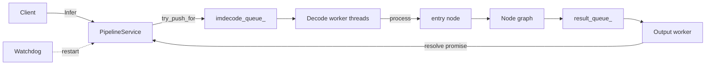

# gRPC interface (vision)

## Overview

The C++ server exposes the vision pipeline through the gRPC service `AxInference`. A client sends one encoded image and receives one `FrameResult` with detections, classifications, or both. The service is unary. It has no streaming RPC. The class `PipelineService` in `server/src/interface/grpc.cpp` implements the service. The class `Ax::GrpcServer` builds the pipeline from a JSON spec, serves requests, and rebuilds the pipeline on restart. The server listens on `0.0.0.0:<port>` without TLS. Each pipeline runs in its own server process on its own port. Clients and operators use this page to learn the wire contract, the status codes, and the server options.

## Architecture



`Infer()` copies the image bytes into a frame from a `FramePool`. It registers a promise for the frame id and pushes the frame into `imdecode_queue_`. A pool of `imdecode_threads` worker threads takes frames from the queue. Each worker owns one decoder and calls `entry_node->process(frame)` after decoding. The node graph runs the frame and the sink writes it to `result_queue_`. One output worker takes finished frames and resolves the matching promise. `Infer()` then calls `fill_response()` to build the `FrameResult`. A watchdog thread and a statistics thread run beside the workers.

## Components

| Component | Description | Reference |
|---|---|---|
| `AxInference` service | One unary RPC, `Infer(InferRequest) returns (FrameResult)`. | [proto reference](../reference/proto/index.md) |
| `PipelineService` | Implements `Infer()`, the workers, the watchdog and the statistics. | [grpc reference](../reference/grpc/index.md) |
| `GrpcServerConfig` | Runtime settings, filled from the command line by `main()`. | [grpc reference](../reference/grpc/index.md) |
| `FramePool` | Recycles `Frame` objects. The pool holds `max_streams * 1.5` frames. | [grpc reference](../reference/grpc/index.md) |
| `fill_response()` | Converts frame meta results into the `FrameResult` message. | [grpc reference](../reference/grpc/index.md) |
| `inference.proto` | Wire contract in `proto/axinfer/v1/inference.proto`, package `axinfer.v1`. | [proto reference](../reference/proto/index.md) |

## Proto messages

| Message | Fields |
|---|---|
| `InferRequest` | `image_data` (bytes, encoded image such as JPEG or PNG) and optional `request_id`. |
| `FrameResult` | `detections`, `classifications`, optional `request_id`, optional `status`, optional `status_message`. |
| `Detection` | `class_id`, `label`, `score`, `bbox`, `classifications`, `keypoints`, `segmentation`, `track_id`, `track_history`, `face_bbox`, `face_landmarks`, `embeddings`. |
| `BoundingBox` | `x`, `y`, `w`, `h` as uint32 pixels. |
| `Point2D` | `x`, `y` and optional `confidence`. |
| `ClassScore` | `class_id`, `label`, `score`. |
| `NamedEmbedding` | `key` and a repeated float `vector`. |

The enum `InferenceStatus` has two values: `COMPLETE = 0` and `DROPPED = 1`. The proto reserves field numbers 12 and 13 and the names `embedding` and `reid_embedding` in `Detection`. The server sets `request_id` in the result when the request carries one.

## Flow

1. `Infer()` returns `UNAVAILABLE` unless the server state is `READY`.
2. `Infer()` copies the image into a pooled frame and registers a promise for the frame id.
3. `Infer()` pushes the frame into `imdecode_queue_` and waits up to `imdecode_queue_timeout_ms`.
4. If the push times out, `Infer()` returns `DROPPED` with `status_message` `imdecode_queue_ full`.
5. A decode worker decodes the image to `output_format` and calls `process()` on the entry node.
6. The node graph runs. A saturated node queue marks the frame dropped and the result reaches the output worker.
7. The output worker resolves the promise with the finished frame.
8. If the frame is dropped, `Infer()` returns `DROPPED` with the node's `drop_reason`.
9. Otherwise `fill_response()` fills the result and `Infer()` returns `COMPLETE`.
10. If nothing resolves the promise within `timeout_s`, `Infer()` returns `DEADLINE_EXCEEDED`.

## Status codes

A drop is not a gRPC error. The call returns `OK` and the result carries `status = DROPPED`.

| Outcome | gRPC status | Result |
|---|---|---|
| Processed | `OK` | `status = COMPLETE`. |
| Decode queue full | `OK` | `status = DROPPED`, `status_message = "imdecode_queue_ full"`. |
| Pipeline dropped the frame | `OK` | `status = DROPPED`, `status_message` holds the node's drop reason. |
| Watchdog restart | `OK` | `status = DROPPED`, `status_message = "server restarted by watchdog"`. |
| Server not `READY` | `UNAVAILABLE` | Message `Server is <state>, please retry`. |
| No result within `timeout_s` | `DEADLINE_EXCEEDED` | Message `Timeout waiting for pipeline result`. |
| Decode failure or pipeline exception | `INTERNAL` | Message `Pipeline error: <reason>`. |

## Building the result

`fill_response()` reads the frame's `Ax::MetaMap`. It chooses the output by the type of each meta entry. It does not depend on the key names.

- It takes detections from the first `AxMetaObjDetection` in the map.
- For each detection it looks for meta keys that end in `_<index>`. `RoiCollectNode` writes these keys.
- `AxMetaClassification` entries become `Detection.classifications`.
- `AxMetaKptsDetection` entries become `keypoints` or, for the role `face`, `face_bbox` and `face_landmarks`.
- `AxMetaEmbeddings` entries become `NamedEmbedding` values keyed by the meta key prefix.
- `AxMetaSegmentsDetection` entries become a simplified polygon in `segmentation`.
- A top-level meta key `classifications` becomes `FrameResult.classifications`.
- Without an object detection, the function builds detections from the first non-empty keypoint meta and from the first non-empty segment meta.
- Coordinates add the ROI crop origin when the frame records one. Otherwise they add the detection box origin.
- The `meta_key_roles` map assigns the role `keypoints` or `face` to a meta key. A key without an entry has the role `keypoints`.
- The keypoint count comes from the meta shape and defaults to 17. The face landmark count defaults to 5.
- The segmentation mapping assumes a 640x640 letterboxed model input and a mask stride of 4.

## Configuration

`main()` fills `GrpcServerConfig` from command-line options. The pipeline launcher passes the options for the settings in the pipeline spec. The positional argument `labels.txt` (or a `.names` file) sets class names. If none is given, the server reads the default labels file under `$AXELERA_FRAMEWORK`.

| Option | Default | Effect |
|---|---|---|
| `--pipeline-spec` | none | Path to the pipeline JSON spec. Required. |
| `--port` | 50051 | TCP listen port. |
| `--timeout` | 1 | Seconds `Infer()` waits for a result. Must be positive. |
| `--imdecode-threads` | hardware concurrency | Number of decode worker threads. |
| `--imdecode-queue-depth` | 1 | Capacity of `imdecode_queue_`. |
| `--imdecode-queue-timeout-ms` | 2000 | Wait for space in `imdecode_queue_` before `DROPPED`. |
| `--output-format` | `BGR` | Pixel format of decoded frames: `BGR`, `I420` or `RGBA`. |
| `--restart-interval` | 0 | Seconds between automatic pipeline restarts. 0 disables. |
| `--watchdog-timeout-ms` | 0 | Watchdog threshold in milliseconds. 0 disables. |
| `--max-streams` | 100 | Concurrent stream limit. Also sizes the frame pool at 1.5 times this value. |
| `--quota-mb` | 500 | gRPC resource quota in megabytes. |
| `--high-bandwidth` | off | Swaps the default channel settings for a high-bandwidth set. |
| `--meta-key-role` | none | Repeatable `<key>=<role>` pair for `meta_key_roles`. |

The tuning trade-offs are in [tuning.md](../tuning/tuning.md).

## Health watchdog

`watchdog_loop()` runs only when `watchdog_timeout_ms` is greater than 0. It polls every `watchdog_timeout_ms` clamped to the range 200 to 1000 ms. It fires only after at least one request has succeeded. It also requires at least 3 requests since the last success and a stall longer than `watchdog_timeout_ms`. On a trigger it resolves every pending request as `DROPPED` and requests a pipeline restart. The watchdog thread then exits. The restarted service starts a new watchdog.

## Restart, signals and statistics

| Trigger | Effect |
|---|---|
| `SIGINT`, `SIGTERM` | Shut the server down. |
| `SIGRTMIN+1` | Restart the pipeline. |
| `SIGRTMIN+2` | Print statistics without a restart. |
| `restart_interval_s` elapsed | Restart the pipeline. |
| Watchdog trigger | Restart the pipeline. |

On shutdown the server stops accepting calls and stops the decode workers. It waits for pending requests for up to `timeout_s + 2` seconds. Then it stops the output worker and every node. The statistics thread logs every 1500 ms. `LogServerStatistics()` writes a `STATS_JSON` line with these fields: `total_frames`, `dropped_frames`, `avg_latency_ms`, `seconds_since_last_success`, `requests_since_last_success`, `healthy`, `imdecode_queue_used`, `imdecode_queue_depth`, `pending_requests` and `node_queues`. Each `node_queues` entry holds `id`, `input_used`, `input_depth`, `result_used` and `result_depth`. The host server reads this line (see [host-server.md](../host-server/host-server.md)).

## Constraints

- The service has one unary RPC. It has no streaming.
- The server uses insecure credentials. It does not offer TLS.
- Only one `GrpcServer` per process works, because the shutdown and restart flags are process-wide.
- The server accepts calls only in state `READY`. A restart returns `UNAVAILABLE` until the new pipeline is ready.
- Default mode leaves the gRPC default receive message limit in place. `--high-bandwidth` removes the limit.
- `--high-bandwidth` also sets 16 MB TCP buffers, larger HTTP/2 windows, keepalive, a 15 s idle limit and a 3600 s connection age limit.
- Each `Infer()` call reserves a 50 MB buffer for the encoded image.
- Decoding fails with `INTERNAL` for data that no decoder reads.
- The wire contract is versioned by path (`axinfer/v1`). VLM and LLM serving does not use gRPC.
- The server ignores unknown `--` flags with a warning. It exits with status 1 on an invalid value for a known flag.

## Quick Example

Start the server. The client QuickStart ([client/QUICKSTART.md](../../../client/QUICKSTART.md)) and [server/QUICKSTART.md](../../QUICKSTART.md) cover the full setup.

```bash
axinferencenet_grpc --pipeline-spec pipeline.json --port 50051 --timeout 5
```

Call it from Python with the generated stubs.

```python
import grpc
from axinfer.v1 import inference_pb2, inference_pb2_grpc

channel = grpc.insecure_channel("localhost:50051")
stub = inference_pb2_grpc.AxInferenceStub(channel)
req = inference_pb2.InferRequest(image_data=open("img.jpg", "rb").read(), request_id="r1")
res = stub.Infer(req, timeout=5)
if res.status == inference_pb2.InferenceStatus.DROPPED:
    print("dropped:", res.status_message)
else:
    print(len(res.detections), "detections")
```

## Related

- [Tuning reference](../tuning/tuning.md)
- [Vision pipeline](../vision/pipeline.md)
- [Image decoding](../vision/image-decoding.md)
- [Host server](../host-server/host-server.md)
- [VLM and LLM serving](../vllm/serving.md)

## Source files

- `proto/axinfer/v1/inference.proto`
- `server/include/interface/grpc.h`
- `server/src/interface/grpc.cpp`
- `server/src/main.cpp`
- `server/include/pipeline/timed_queue_push.h`
- `deployment/launch_remote.py`
