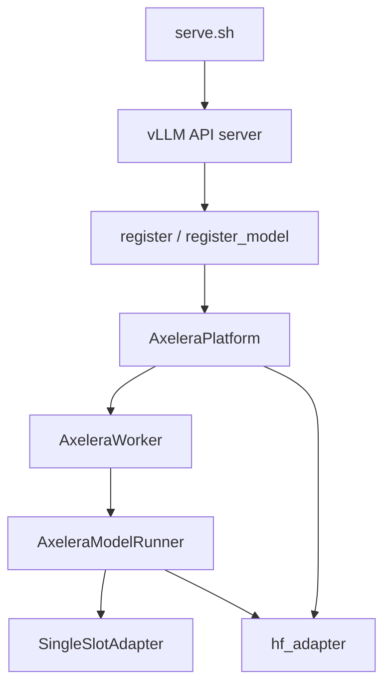

# axplugin reference

## Overview

`axplugin` is the out-of-tree vLLM plugin in `server/vllm/axelera/axplugin`. It runs compiled Axelera Metis artifacts behind the vLLM OpenAI API server. The package registers a CPU-style platform, a worker, a model runner and marker model classes. `serve.sh` starts the server. See the concept pages [axplugin.md](../../vllm/axplugin.md) and [serving.md](../../vllm/serving.md).

## Architecture



## Pages

| Page | Kind | Summary |
|---|---|---|
| [ArtifactManifest](ArtifactManifest.md) | class | Frozen dataclass that holds the sizing information of a compiled artifact. |
| [AxPassthroughDummyInputsBuilder](AxPassthroughDummyInputsBuilder.md) | class | Dummy-input builder that produces an empty prompt and no multimodal data. |
| [AxPassthroughMultiModalProcessor](AxPassthroughMultiModalProcessor.md) | class | Multimodal processor that forwards images and chat messages to the runner. |
| [AxPassthroughProcessingInfo](AxPassthroughProcessingInfo.md) | class | Processing info for models whose images and chat messages reach the runner unprocessed. |
| [AxSingleSlotTextModel](AxSingleSlotTextModel.md) | class | Registry marker for text-only single-slot Axelera models. |
| [AxSingleSlotVisionModel](AxSingleSlotVisionModel.md) | class | Registry marker for image-and-text single-slot Axelera models. |
| [AxeleraModelRunner.load_model](AxeleraModelRunner.load_model.md) | method | Load the artifact onto its Metis device and create the step executor. |
| [AxeleraModelRunner](AxeleraModelRunner.md) | class | Minimal vLLM model runner for Axelera artifacts. |
| [AxeleraPlatform.check_and_update_config](AxeleraPlatform.check_and_update_config.md) | method | Adapt the vLLM config to the compiled artifact. |
| [AxeleraPlatform](AxeleraPlatform.md) | class | vLLM out-of-tree platform for Axelera Metis artifacts. |
| [AxeleraWorker](AxeleraWorker.md) | class | vLLM worker that runs on the CPU and delegates execution to `AxeleraModelRunner`. |
| [SINGLE_SLOT_SPECS](SINGLE_SLOT_SPECS.md) | constant | Table that maps each artifact `model_type` to its `SingleSlotSpec`. |
| [SingleSlotAdapter.admit](SingleSlotAdapter.admit.md) | method | Run the prefill for a request and sample its first token. |
| [SingleSlotAdapter](SingleSlotAdapter.md) | class | Drives a loaded model with one live request at a time. |
| [SingleSlotRequest](SingleSlotRequest.md) | class | Dataclass that `SingleSlotAdapter.admit` returns. |
| [SingleSlotSpec](SingleSlotSpec.md) | class | Frozen dataclass that describes one supported single-slot model family. |
| [decode_image](decode_image.md) | function | Return an image tensor as a NumPy array. |
| [decode_messages](decode_messages.md) | function | Return the chat messages stored in a `uint8` tensor. |
| [disable_accelerator_cache_ops](disable_accelerator_cache_ops.md) | function | Replace `torch.accelerator` cache functions with no-ops. |
| [encode_image](encode_image.md) | function | Convert an image to a `uint8` tensor so it can pass through vLLM's multimodal pipeline. |
| [encode_messages](encode_messages.md) | function | Serialize chat messages to JSON and return the UTF-8 bytes as a `uint8` tensor. |
| [hf_overrides_for](hf_overrides_for.md) | function | Compute the vLLM `hf_overrides` for an artifact. |
| [install_messages_passthrough_patch](install_messages_passthrough_patch.md) | function | Patch `HfRenderer` so chat messages reach the multimodal processor. |
| [load_model_class](load_model_class.md) | function | Import the vLLM marker model class for the configured artifact. |
| [load_single_slot_adapter](load_single_slot_adapter.md) | function | Load an artifact through transformers and wrap it in a `SingleSlotAdapter`. |
| [read_manifest](read_manifest.md) | function | Read the manifest of the artifact configured in a vLLM config. |
| [read_single_slot_manifest](read_single_slot_manifest.md) | function | Read the artifact manifest file named by a spec. |
| [register](register.md) | function | Return the platform class path for vLLM's `vllm.platform_plugins` entry point. |
| [register_model](register_model.md) | function | Register the Axelera marker model classes with vLLM through the `vllm.general_plugins` entry point. |
| [resolve_artifact_dir](resolve_artifact_dir.md) | function | Return the compiled artifact directory for a vLLM config. |
| [resolve_single_slot_spec](resolve_single_slot_spec.md) | function | Find the `SingleSlotSpec` for an artifact directory. |
| [sample_next_token](sample_next_token.md) | function | Pick the next token id from a logits vector. |
| [serve.sh](serve.sh.md) | script | Script that serves one compiled Axelera artifact with the vLLM OpenAI-compatible API server. |

## Quick Example

Check which `hf_overrides` an artifact needs and which spec it resolves to. Run it from `server/vllm/axelera` with the vLLM environment Python.

```python
from pathlib import Path
from axplugin import hf_adapter

d = Path("/path/to/artifact_dir")
print(hf_adapter.hf_overrides_for(d))
print(hf_adapter.resolve_single_slot_spec(d))
```
