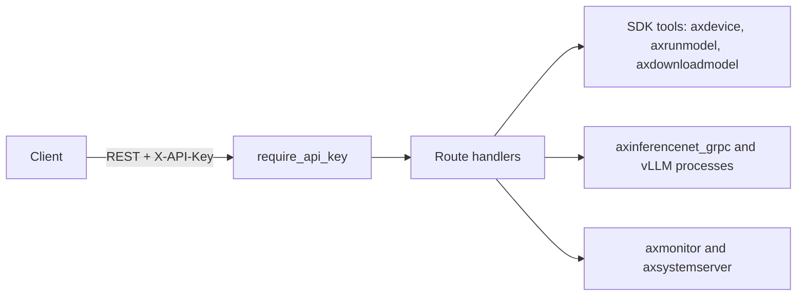

# host_server reference

## Overview

`deployment/host_server.py` is the FastAPI app that serves the `/api/v1` REST control plane of the deployment host.
Clients upload specs, maintain devices, provision models, launch pipelines and vLLM servers, and read AxMonitor telemetry.
Every route except `GET /api/v1/health` requires the `X-API-Key` header.
The concept page is [Host server](../../host-server/host-server.md). The vLLM routes also relate to [vLLM serving](../../vllm/serving.md).

## Architecture



## Pages

| Page | Kind | Summary |
|---|---|---|
| [`GET /api/v1/health`](./health.md) | route | Reports that the host server process is alive. |
| [Authentication (`require_api_key`)](./authentication.md) | function | Checks the `X-API-Key` header against `DEPLOYMENT_API_KEY` on every protected route. |
| [`POST /api/v1/yaml`](./upload-yaml.md) | route | Stores an uploaded YAML file in `YAML_UPLOAD_DIR`. |
| [`GET /api/v1/sdk-root`](./sdk-root.md) | route | Returns the SDK root directory configured on the host. |
| [`POST /api/v1/server/restart`](./server-restart.md) | route | Restarts the host server process through a detached watchdog. |
| [`GET /api/v1/models`](./list-models.md) | route | Lists the compiled vision models and VLM artifact directories under the SDK root. |
| [`GET /api/v1/models/{name}/meta-key`](./get-model-meta-key.md) | route | Looks up a model's meta key in the SDK model zoo. |
| [`GET /api/v1/devices`](./list-devices.md) | route | Lists the Metis devices on the host. |
| [`GET /api/v1/devices/{device_id}/axdevice`](./device-axdevice-status.md) | route | Reports one device's `axdevice -v` line and its parsed power limit. |
| [`POST /api/v1/devices/{device_id}/axdevice`](./device-axdevice.md) | route | Refreshes a device, reloads its firmware and/or sets its power limit through `axdevice`. |
| [`GET /api/v1/monitor/stats`](./monitor-stats.md) | route | Returns one parsed AxMonitor snapshot for all devices. |
| [`POST /api/v1/monitor/restart`](./monitor-restart.md) | route | Restarts the `axsystemserver` service and clears the stats cache. |
| [`POST /api/v1/monitor/workers/{device_index}/start`](./monitor-worker-start.md) | route | Starts buffering AxMonitor samples for a device, or updates the interval of an existing worker. |
| [`POST /api/v1/monitor/workers/{device_index}/stop`](./monitor-worker-stop.md) | route | Stops buffering for a device and discards its samples. |
| [`GET /api/v1/monitor/workers`](./monitor-workers-list.md) | route | Lists the active monitor workers. |
| [`GET /api/v1/monitor/workers/{device_index}/samples`](./monitor-worker-samples.md) | route | Returns buffered AxMonitor samples for a device. |
| [`POST /api/v1/devices/health`](./device-health-check.md) | route | Runs a health check on the listed devices, or on all devices, and waits for the result. |
| [`POST /api/v1/devices/health/all`](./device-health-check-all.md) | route | Runs a health check on every device and waits for the result. |
| [`POST /api/v1/devices/health/{index}`](./device-health-check-one.md) | route | Runs a health check on one device and waits for the result. |
| [`POST /api/v1/devices/health/all/start`](./device-health-check-async-start.md) | route | Starts a background health check of all devices and returns at once. |
| [`GET /api/v1/devices/health/status`](./device-health-check-async-status.md) | route | Returns the progress of the background health check. |
| [`POST /api/v1/devices/throughput`](./device-throughput.md) | route | Measures frame throughput on the listed devices and waits for the result. |
| [`GET /api/v1/devices/numa_plan`](./device-numa-plan.md) | route | Plans CPU pinning so each device gets its own block of CPUs on its NUMA node. |
| [`GET /api/v1/devices/cpu_topology`](./device-cpu-topology.md) | route | Reports the host's NUMA nodes and CPU counts. |
| [`GET /api/v1/prebuilt-models`](./list-prebuilt-models.md) | route | Lists the models that `axdownloadmodel` can fetch. |
| [`POST /api/v1/prebuilt-models/download`](./download-prebuilt-model.md) | route | Downloads a prebuilt model and generates its `.axnet` file under `SDK_ROOT/build/<name>/`. |
| [`POST /api/v1/prebuilt-models/patch-meta-key`](./patch-model-meta-key.md) | route | Rewrites the `meta_key` values in a provisioned model's `.axnet` file in place. |
| [`POST /api/v1/pipeline-spec`](./upload-pipeline-spec.md) | route | Stores a pipeline spec under `SDK_ROOT/pipeline_specs/<pipeline_id>/<filename>`. |
| [`POST /api/v1/pipelines/launch`](./pipeline-launch.md) | route | Launches `axinferencenet_grpc` for a stored pipeline spec and waits until its port opens. |
| [`GET /api/v1/pipelines/{pipeline_id}/queue-stats`](./pipeline-queue-stats.md) | route | Returns the latest queue statistics that a launched pipeline logged. |
| [`POST /api/v1/pipelines/shutdown`](./pipeline-shutdown.md) | route | Stops the pipeline process that this server launched under a pipeline id. |
| [`POST /api/v1/pipelines/cleanup-all`](./pipeline-cleanup-all.md) | route | Stops every `axinferencenet_grpc` process on the host and every tracked vLLM instance. |
| [`GET /api/v1/vllm/artifacts`](./vllm-artifacts.md) | route | Lists the compiled vLLM artifacts under `SDK_ROOT/build`. |
| [`POST /api/v1/vllm/launch`](./vllm-launch.md) | route | Launches a vLLM server with `serve.sh` and waits up to 180 s for its port. |
| [`POST /api/v1/vllm/shutdown`](./vllm-shutdown.md) | route | Stops the vLLM instance that this server launched under a name. |
| [`GET /api/v1/vllm/status`](./vllm-status.md) | route | Lists the vLLM instances that this server launched and whether each still runs. |
| [`POST /api/v1/benchmark-media/fetch`](./benchmark-media-fetch.md) | route | Starts a background fetch of the benchmark media files. |
| [`GET /api/v1/benchmark-media/status`](./benchmark-media-status.md) | route | Reports the progress of the benchmark media fetch. |

## Quick Example

```bash
BASE="http://<host>:8088"
curl -sS "$BASE/api/v1/health"
curl -sS -H "X-API-Key: $DEPLOYMENT_API_KEY" "$BASE/api/v1/devices"
```
