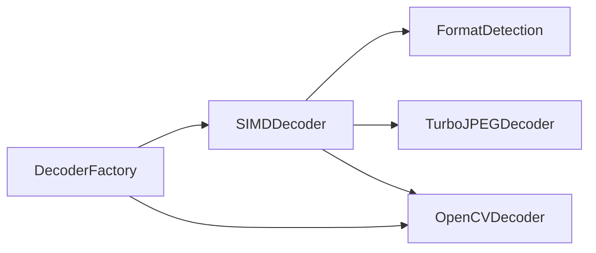

# Image decoding reference

## Overview
The image decoding area holds the C++ classes that turn encoded JPEG and PNG bytes into BGR or I420 pixels. All classes are header-only under `server/include/decoders`. See the concept page [Image decoding](../../vision/image-decoding.md).

## Architecture


## Pages
| Page | Kind | Summary |
|---|---|---|
| [ImageDecoder](ImageDecoder.md) | class | Abstract decoder interface. |
| [ImageDecoder.decode](ImageDecoder.decode.md) | function | Decode to a BGR `cv::Mat`. |
| [ImageDecoder.decode_ex](ImageDecoder.decode_ex.md) | function | Decode to a requested output format. |
| [ImageDecoder.decode_to_videobuffer](ImageDecoder.decode_to_videobuffer.md) | function | Decode into an `Ax::VideoBuffer`. |
| [ImageFormat](ImageFormat.md) | class | Input and output format identifiers. |
| [FormatDetection](FormatDetection.md) | class | Magic-byte format detection helper. |
| [FormatDetection.detect](FormatDetection.detect.md) | function | Return `JPEG` or `UNKNOWN`. |
| [DecoderFactory](DecoderFactory.md) | class | Creates the decoder for this build. |
| [OpenCVDecoder](OpenCVDecoder.md) | class | Decoder backed by `cv::imdecode`. |
| [TurboJPEGDecoder](TurboJPEGDecoder.md) | class | JPEG-only decoder backed by libjpeg-turbo. |
| [SIMDDecoder](SIMDDecoder.md) | class | TurboJPEG for JPEG, OpenCV fallback. |

## Quick Example
```cpp
#include "decoders/decoder_factory.hpp"

auto decoder = DecoderFactory::create_decoder();
cv::Mat bgr;
if (decoder->decode(bytes, bgr)) {
    // bgr is an 8-bit, 3-channel image.
}
```
