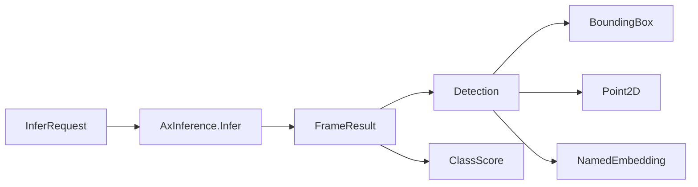

# Proto reference

## Overview

This area documents the messages, the enum and the service of the vision wire contract. The contract is `proto/axinfer/v1/inference.proto` in package `axinfer.v1`. The service is `AxInference` with one unary RPC. The concept page is [gRPC interface](../../interfaces/grpc.md). The server code is in the [gRPC server reference](../grpc/index.md).

## Architecture



## Pages

| Page | Kind | Summary |
|---|---|---|
| [AxInference](AxInference.md) | service | Unary `Infer` RPC and its status codes. |
| [InferRequest](InferRequest.md) | message | One encoded image and an optional request id. |
| [FrameResult](FrameResult.md) | message | Detections, classifications and status for one image. |
| [Detection](Detection.md) | message | One detected object with optional attributes. |
| [BoundingBox](BoundingBox.md) | message | Axis-aligned box in pixels. |
| [Point2D](Point2D.md) | message | 2D point with an optional confidence. |
| [ClassScore](ClassScore.md) | message | Class id, label and score. |
| [NamedEmbedding](NamedEmbedding.md) | message | Feature vector identified by a key. |
| [InferenceStatus](InferenceStatus.md) | enum | `COMPLETE` or `DROPPED`. |

## Quick Example

```python
from axinfer.v1 import inference_pb2

req = inference_pb2.InferRequest(image_data=open("img.jpg", "rb").read(), request_id="r1")
```
