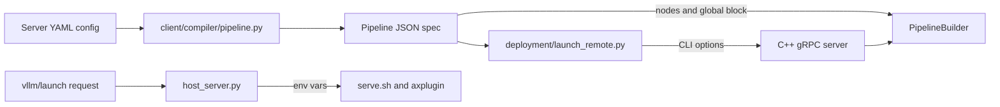

# Tuning reference

## Overview

This page lists the settings that change throughput, latency and drop behavior of the inference server. Vision settings come from the server YAML config (`ServerConfig` in `client/configs/utils/config_schema.py`). The compiler turns them into a pipeline JSON spec. `deployment/launch_remote.py` passes them to the C++ server as command-line options. VLM and LLM settings come from the `vllm/launch` request. The page lists only fields that the code reads.

## Architecture



The compiler writes the `global` block of the pipeline spec from `PipelineConfig` and `GlobalSettings`. The launcher reads that block and builds the server command line. `PipelineBuilder` reads the `global` block and the node fields for queue sizes. Node-level fields pass from the YAML node to the spec unchanged. The vLLM path does not use the pipeline spec. `host_server.py` exports the launch request as environment variables for `serve.sh`.

## Components

| Component | Description | Reference |
|---|---|---|
| `GlobalSettings` | Shared YAML settings: `restart_interval`, `watchdog_timeout_ms`, `result_queue_depth`. | [client configs reference](../../../client/docs/reference/configs/index.md) |
| `PipelineConfig` | Per-pipeline YAML settings: `timeout`, `imdecode_*`, `im_decode_output_format`. | [client configs reference](../../../client/docs/reference/configs/index.md) |
| `GraphNodeConfig` | Node settings: `queue_depth`, `queue_timeout_ms`, `max_iters`, `dispatch_queue_depth`. | [nodes reference](../reference/nodes/index.md) |
| `GrpcServerConfig` | Server runtime settings set by command-line options. | [grpc reference](../reference/grpc/index.md) |
| `VllmLaunchRequest` | VLM and LLM launch parameters. | [host_server reference](../reference/host_server/index.md) |

## Configuration

### Vision: pipeline level

Set these under `pipelines:` in the YAML config.

| Setting | Default | Effect |
|---|---|---|
| `timeout` | 5 | Seconds `Infer()` waits for a result. The compiler writes it as `timeout_s`. A short value returns `DEADLINE_EXCEEDED` on slow pipelines. |
| `imdecode_threads` | auto | Decode worker threads. If unset, the launcher uses 4 per pinned CPU from `taskset_cpus`. Without pinning, the server uses its hardware concurrency. |
| `imdecode_queue_depth` | 1 | Capacity of the decode queue. A larger value lowers the drop rate and raises queueing latency. |
| `imdecode_queue_timeout_ms` | 2000 | Wait for space in the decode queue. On expiry the request returns `DROPPED`. |
| `im_decode_output_format` | `BGR` | Pixel format of decoded frames: `BGR`, `RGBA` or `I420`. |

### Vision: global level

Set these under `global:` in the YAML config. They apply to every pipeline in the file.

| Setting | Default | Effect |
|---|---|---|
| `watchdog_timeout_ms` | 0 | Restarts the pipeline after a stall longer than this value. 0 disables the watchdog. |
| `restart_interval` | 0 | Seconds between automatic pipeline restarts. 0 disables. |
| `result_queue_depth` | auto | Capacity of the result queue shared by all net nodes, loop guards and the sink. |

The watchdog fires only after a first success, at least 3 requests since the last success, and a stall longer than the threshold. A value shorter than the real latency under load can restart a healthy server.

If `result_queue_depth` is unset, `PipelineBuilder` uses the larger of 16 and twice the node count. A small value raises drops in cascades and multi-net graphs.

### Vision: node level

Set these on a node in `pipelines[].graph.nodes`.

| Setting | Node type | Default | Effect |
|---|---|---|---|
| `queue_depth` | `net` | number of cores of the net replica, at least 1 | Capacity of the input and result queues of the node. |
| `queue_timeout_ms` | `net`, `loop_guard` | 2000 | Wait for queue space before the node drops the frame. |
| `max_iters` | `loop_guard` | 3 | The loop ends when `roi_index` reaches this value. |
| `dispatch_queue_depth` | `loop_guard` | 8 | Capacity of the internal dispatch queue. |

A `net` node with several device groups becomes a round-robin group of replicas. Each replica gets the same `queue_depth`. The core count comes from the `axnet_config` string, for example `net-0;devices:0-4`. A `queue_depth` below the core count limits concurrency of that net.

### Server options without a YAML field

The launcher does not set these options. Pass them with `extra_args` to `launch_server()` or start the binary by hand.

| Option | Default | Effect |
|---|---|---|
| `--max-streams` | 100 | Concurrent stream limit. Also sets the frame pool size to 1.5 times this value. |
| `--quota-mb` | 500 | gRPC resource quota in megabytes. |
| `--high-bandwidth` | off | Swaps the default channel settings for a high-bandwidth set. |

### VLM and LLM

Set these in the `vllm/launch` request (`VllmLaunchRequest`).

| Setting | Default | Effect |
|---|---|---|
| `temperature` | 0.0 | Fixed sampling temperature of the whole process. The plugin ignores a different per-request value and logs one warning. |
| `enable_thinking` | false | `false` passes `enable_thinking: false` as the chat-template default. `true` passes no override. |

Concurrent requests with different temperatures need separate server processes.

## Constraints

- The server binary defaults `--timeout` to 1 second. The compiler always passes `timeout` from the config, so the effective default is 5.
- `timeout` must be positive. `--imdecode-threads`, `--imdecode-queue-depth`, `--max-streams` and `--quota-mb` must be positive.
- `--imdecode-queue-timeout-ms`, `--restart-interval` and `--watchdog-timeout-ms` must not be negative.
- The decoder (SIMD or OpenCV) is a build-time choice. No runtime option selects it.
- A restart makes the server return `UNAVAILABLE` until the new pipeline is ready.

## Quick Example

A pipeline with a longer timeout, a deeper decode queue and a watchdog:

```yaml
global:
  sdk_root: ${SDK_ROOT}
  watchdog_timeout_ms: 5000
  result_queue_depth: 32
pipelines:
  - id: detector
    port: 50051
    timeout: 3
    imdecode_threads: 16
    imdecode_queue_depth: 4
    imdecode_queue_timeout_ms: 500
    graph:
      entry: det
      nodes:
        - {id: det, type: net, net: yolo, queue_depth: 4, queue_timeout_ms: 1000, next: out}
        - {id: out, type: sink}
```

The `nets:` section must define `yolo`. The helper command `python -m helper config isovision` generates a full config (see [client/QUICKSTART.md](../../../client/QUICKSTART.md)).

## Related

- [gRPC interface](../interfaces/grpc.md)
- [Vision pipeline](../vision/pipeline.md)
- [Image decoding](../vision/image-decoding.md)
- [VLM and LLM serving](../vllm/serving.md)
- [Host server](../host-server/host-server.md)

## Source files

- `client/configs/utils/config_schema.py`
- `client/compiler/pipeline.py`
- `deployment/launch_remote.py`
- `deployment/host_server.py`
- `server/src/main.cpp`
- `server/include/interface/grpc.h`
- `server/src/interface/grpc.cpp`
- `server/src/pipeline/builder.cpp`
- `server/include/nodes/guard.h`
- `server/include/nodes/inference.h`
- `server/vllm/axelera/scripts/serve.sh`
- `server/vllm/axelera/axplugin/model_runner.py`
