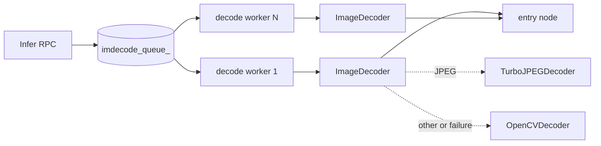

# Image decoding

## Overview

Image decoding turns the encoded bytes of an `InferRequest` into pixels that the vision pipeline can use. The
gRPC server owns a pool of decode worker threads. Each worker owns one `ImageDecoder`. The decoder is a TurboJPEG
decoder with an OpenCV fallback, or an OpenCV-only decoder, depending on the build. A worker writes the result into
`Frame::bgr` or `Frame::video_buffer` and passes the frame to the entry node of the pipeline.

## Architecture



`ImageDecoder` is the abstract interface. `DecoderFactory::create_decoder()` returns a `SIMDDecoder` when the
build defines `HAVE_TURBOJPEG`. Otherwise it returns an `OpenCVDecoder`. `SIMDDecoder` calls `FormatDetection::detect()`
when the input format is `ImageFormat::UNKNOWN`. It sends JPEG data to `TurboJPEGDecoder` and everything else to
`OpenCVDecoder`. All workers share one queue, `imdecode_queue_`. The `Infer` handler pushes each request into this
queue. Every worker creates its own decoder once and then loops on the queue.

## Components

| Component | Description | Reference |
|---|---|---|
| `ImageFormat` | Enum with `JPEG`, `PNG`, `UNKNOWN` (input) and `BGR`, `I420` (output). | [Image decoding](../reference/image-decoding/index.md) |
| `ImageDecoder` | Abstract decoder with `decode()`, `decode_ex()`, `decode_to_videobuffer()` and `name()`. | [Image decoding](../reference/image-decoding/index.md) |
| `DecoderFactory` | Chooses the decoder at compile time and describes it with `get_info()`. | [Image decoding](../reference/image-decoding/index.md) |
| `SIMDDecoder` | Uses TurboJPEG for JPEG and falls back to OpenCV. | [Image decoding](../reference/image-decoding/index.md) |
| `TurboJPEGDecoder` | JPEG-only decoder on libjpeg-turbo. Compiled only with `HAVE_TURBOJPEG`. | [Image decoding](../reference/image-decoding/index.md) |
| `OpenCVDecoder` | Decodes any format that `cv::imdecode` supports. | [Image decoding](../reference/image-decoding/index.md) |
| `FormatDetection` | Detects JPEG from the first three bytes. | [Image decoding](../reference/image-decoding/index.md) |

### Decoder interface

| Method | Signature | Behavior |
|---|---|---|
| `decode` | `bool decode(const std::vector<uint8_t>& encoded, cv::Mat& bgr_out, ImageFormat format = ImageFormat::UNKNOWN)` | Decodes to an 8-bit, 3-channel BGR `cv::Mat`. Pure virtual. |
| `decode_ex` | `bool decode_ex(const std::vector<uint8_t>& encoded, cv::Mat& output, ImageFormat input_format = ImageFormat::UNKNOWN, ImageFormat output_format = ImageFormat::BGR)` | Decodes to BGR or I420. The base class supports only BGR. |
| `decode_to_videobuffer` | `bool decode_to_videobuffer(const std::vector<uint8_t>& encoded, Ax::VideoBuffer& output, ImageFormat input_format = ImageFormat::UNKNOWN, ImageFormat output_format = ImageFormat::I420)` | Decodes into an `Ax::VideoBuffer`. The base class returns false. |
| `name` | `const char* name() const` | Returns the decoder name for log messages. Pure virtual. |

For I420, `decode_ex` fills a single-channel `cv::Mat` with `height * 3 / 2` rows.

### Decoder behavior

| Decoder | `decode` | `decode_ex` | `decode_to_videobuffer` |
|---|---|---|---|
| `OpenCVDecoder` | `cv::imdecode`. Ignores the format hint. | BGR, or I420 through `cv::cvtColor`. | I420 only. Converts from BGR and copies. |
| `TurboJPEGDecoder` | JPEG to BGR with `TJFLAG_FASTDCT` and `TJFLAG_FASTUPSAMPLE`. | BGR, or I420 with `tjDecompressToYUV2`. | I420 only with `tjDecompressToYUV2`. |
| `SIMDDecoder` | TurboJPEG for JPEG, otherwise OpenCV. | Same rule. | Same rule. |

`TurboJPEGDecoder` returns false immediately when the input format is `ImageFormat::PNG`.
`SIMDDecoder` retries with `OpenCVDecoder` when the TurboJPEG decode returns false.
`decode_to_videobuffer` reallocates the buffer when its size or format does not match the image.

### Format detection

`FormatDetection::detect(const std::vector<uint8_t>& encoded)` returns `ImageFormat::JPEG` when the data starts with
`FF D8 FF`. It returns `ImageFormat::UNKNOWN` for every other input and for inputs shorter than 3 bytes.
It never returns `ImageFormat::PNG`. `OpenCVDecoder` accepts any format `cv::imdecode` supports.

## Flow

1. The `Infer` handler copies `image_data` into `Frame::encoded`.
2. The handler pushes the frame into `imdecode_queue_` and waits up to `imdecode_queue_timeout_ms`.
3. If the queue stays full, the handler answers with status `DROPPED` and the message `imdecode_queue_ full`.
4. A decode worker takes the frame from the queue.
5. With I420 output, the worker calls `decode_to_videobuffer` and falls back to `decode_ex` with BGR output if it fails.
6. With BGR or RGBA output, the worker calls `decode_ex` with BGR output. For RGBA it then converts with `cv::cvtColor`.
7. The worker releases `Frame::encoded` and calls `entry_node_->process(frame)`.
8. If decoding fails, the worker delivers an exception to the request. The RPC returns gRPC status `INTERNAL`.

## Configuration

The output format and the queue settings come from the server command line.

| Setting | Default | Effect |
|---|---|---|
| `--output-format` | `BGR` | Output format of the decode workers: `BGR`, `RGBA` or `I420`. |
| `--imdecode-threads` | hardware concurrency | Number of decode workers. Each worker owns one decoder. |
| `--imdecode-queue-depth` | 1 | Capacity of `imdecode_queue_`. |
| `--imdecode-queue-timeout-ms` | 2000 | Wait for queue space before the request is dropped. |
| `USE_SIMD_DECODE` (build-time env var) | unset | Value `1` makes CMake search for libjpeg-turbo and define `HAVE_TURBOJPEG`. |

The YAML keys `im_decode_output_format`, `imdecode_threads`, `imdecode_queue_depth` and `imdecode_queue_timeout_ms`
of a pipeline entry set these options. See [Vision pipeline](pipeline.md).

## Constraints

- The decoder is chosen at build time. A running server cannot switch decoders.
- `USE_SIMD_DECODE=1` is not enough. CMake must also find `libjpeg-turbo` (`turbojpeg` library and `turbojpeg.h`).
- If the `TurboJPEGDecoder` constructor throws, `SIMDDecoder` serves all input with OpenCV. The decoder name stays `SIMDDecoder`.
- Only JPEG uses TurboJPEG. A JPEG that TurboJPEG rejects goes to OpenCV.
- An `ImageDecoder` instance must not be shared between threads. The server creates one decoder per worker.
- The worker log line `Pipeline decode thread <n> using: <name>` shows the decoder name of each worker.
- `DecoderFactory::get_info()` returns a one-line description of the compiled decoder choice.

## Quick Example

Build the server with SIMD JPEG decoding and start it with four decode workers and I420 output.

```bash
USE_SIMD_DECODE=1 cmake -S server -B server/build && cmake --build server/build
```

```bash
./axinferencenet_grpc --pipeline-spec pipeline_0.json --imdecode-threads 4 --output-format I420
```

The binary name and build directory depend on your setup. See [server quickstart](../../QUICKSTART.md).

## Related

- [Vision pipeline](pipeline.md)
- [gRPC interface](../interfaces/grpc.md)
- [Tuning](../tuning/tuning.md)
- [Server quickstart](../../QUICKSTART.md)

## Source files

- server/include/decoders/image_decoder.hpp
- server/include/decoders/decoder_factory.hpp
- server/include/decoders/format_detection.hpp
- server/include/decoders/simd_decoder.hpp
- server/include/decoders/turbojpeg_decoder.hpp
- server/include/decoders/opencv_decoder.hpp
- server/src/interface/grpc.cpp
- server/src/main.cpp
- server/CMakeLists.txt
