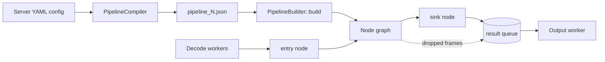

# Vision pipeline

## Overview

The vision pipeline is a graph of nodes that processes each decoded image. A JSON spec file describes the graph.
`PipelineBuilder` reads the spec and returns a wired `BuiltPipeline`. The gRPC server passes every decoded frame
to the entry node. Nodes run nets, filter detections, crop regions of interest (ROIs), branch on predicates and
loop. A sink node pushes finished frames into a shared result queue. Users do not write the JSON by hand. They
write a YAML config and `client/compiler/pipeline.py` compiles it into one JSON spec per pipeline.

## Architecture



`AxPipelineNode` is the base class of every node. A node receives a frame in `process()` and forwards it to the
callback set by `set_next()`. `ConditionNode`, `RoiIterNode` and `LoopGuardNode` have extra callbacks for their
branch targets. `InferenceNode` owns bounded queues and worker threads. `PipelineBuilder::build()` creates every
node first and wires the callbacks in a second pass. Forward references therefore resolve. A reference to an
unknown node throws at build time. `Frame` carries the decoded image, the `meta` map and the drop state through
the graph. Each node reads and writes results in `Frame::meta` under a meta key.

## Components

| Component | Description | Reference |
|---|---|---|
| `AxPipelineNode` | Base class with `process()`, `set_next()`, `stop()` and `queue_occupancy()`. | [Nodes](../reference/nodes/index.md) |
| `PipelineBuilder` | Builds a `BuiltPipeline` from a JSON spec file. | [Nodes](../reference/nodes/index.md) |
| `InferenceNode` (`net`) | Runs one compiled net through bounded queues and two worker threads. | [Nodes](../reference/nodes/index.md) |
| `FilterNode` (`filter`) | Removes detections by class, score, size, count and selection rule. | [Nodes](../reference/nodes/index.md) |
| `RoiIterNode` (`roi_iter`) | Crops one detected box per pass for a second-stage net. | [Nodes](../reference/nodes/index.md) |
| `RoiCollectNode` (`roi_collect`) | Renames per-ROI results and advances the ROI index. | [Nodes](../reference/nodes/index.md) |
| `ConditionNode` (`condition`) | Routes a frame to `then` or `else` using a predicate. | [Nodes](../reference/nodes/index.md) |
| `RenameNode` (`rename`) | Moves one meta entry to a new key. | [Nodes](../reference/nodes/index.md) |
| `LoopGuardNode` (`loop_guard`) | Decides after each pass whether to repeat or exit a loop. | [Nodes](../reference/nodes/index.md) |
| `sink` | Pushes the frame into the result queue. The builder defines this node inline. | [Nodes](../reference/nodes/index.md) |
| `MetaKeyExistsPredicate` | True when `Frame::meta` has the key. | [Nodes](../reference/nodes/index.md) |
| `KptsConfidencePredicate` | True when selected keypoints of the first detection exceed a visibility value. | [Nodes](../reference/nodes/index.md) |
| `PluginPredicate` | Loads a predicate from a shared library with `dlopen`. | [Nodes](../reference/nodes/index.md) |
| `PipelineCompiler` | Compiles the YAML config into JSON specs and process launch descriptions. | [Client compiler](../../../client/docs/client/compiler.md) |

## Flow

1. `PipelineCompiler.compile_all()` writes `pipeline_<index>.json` for each entry of `pipelines:`.
2. The server starts with `--pipeline-spec <path.json>` and calls `PipelineBuilder::build()`.
3. `build()` reads the nets, creates the result queue, creates the predicates and creates every node.
4. `build()` wires `next`, `skip_to`, `then`, `else`, `continue_to` and `exit_to` in a second pass.
5. A decode worker hands each decoded frame to the entry node (see [Image decoding](image-decoding.md)).
6. Each node processes the frame and calls the callback of its successor.
7. The sink node pushes the frame into the result queue.
8. The output worker takes the frame from the result queue and resolves the waiting request (see [gRPC interface](../interfaces/grpc.md)).

### Node types

| JSON `type` | Fields | Behavior |
|---|---|---|
| `net` | `net` (required), `queue_depth`, `queue_timeout_ms` | Runs the named net. Drops the frame if the input queue stays full past `queue_timeout_ms`. |
| `filter` | `meta_key` (required), `classes`, `min_score`, `max_score`, `min_width`, `min_height`, `top_k`, `which` | Filters detections in place. A negative number disables a criterion. |
| `roi_iter` | `meta_key` (required), `crop_padding`, `skip_to` (required), `next` | Crops the box at `roi_index`. Sends the frame to `skip_to` when no box is left. |
| `roi_collect` | `det_meta_key` (required), `cls_meta_key` (required, string or array), `next` | Renames each `cls_meta_key` entry to `<key>_<roi_index>`. Adds `_roi_done` after the last ROI. |
| `condition` | `predicate` (required), `then` (required), `else` (required) | Evaluates the predicate. Ignores `next`. |
| `rename` | `rename_from` (required), `rename_to` (required), `next` | Moves the meta entry. Forwards the frame unchanged when the source key is absent. |
| `loop_guard` | `until` (required), `continue_to` (required), `exit_to` (required), `max_iters`, `dispatch_queue_depth`, `queue_timeout_ms` | Exits when `until` is true or `roi_index` reaches `max_iters`. Otherwise continues. |
| `sink` | none | Ends the graph. Pushes the frame into the result queue. |

`filter` option `which` accepts `all`, `highest_score` or `center`. The default is `all`.
When the `meta_key` is missing or has another type, `filter` stores an empty object detection under that key.
`roi_iter` clamps the padded box to the image. It saves a full-size copy of the image on the first pass and restores it on exit.
`loop_guard` queues frames and handles them on its own thread. It logs and drops a frame when its queue stays full.
If a successor callback is not set, `condition` drops the frame.

### Predicates

The `predicates` object maps a predicate name to a definition. The `type` field selects the predicate. The server
accepts three types. Any other type makes `build()` throw.

| `type` | Fields | Behavior |
|---|---|---|
| `meta_key_exists` | `meta_key` | True when `Frame::meta` contains the key. |
| `kpts_conf_gt` | `meta_key`, `indices`, `value` | True when every listed keypoint of the first detection has visibility above `value`. |
| `plugin` | `so_path` | Loads a shared library that exports `ax_create_predicate` and `ax_destroy_predicate`. |

`kpts_conf_gt` is false when the key is missing, has another type, or an index is out of range.
`client/compiler/predicate.py` turns an `expr` predicate of the YAML config into a `plugin` predicate.

### Cascade patterns

| Pattern | Node chain |
|---|---|
| Single stage | `net` to `sink` |
| Two-stage cascade | `net(detect)` to `roi_iter` to `net(classify)` to `roi_collect` to `loop_guard` to `sink` |
| Conditional cascade | `net(pose)` to `condition` with `then` to `net(face)` and `else` to `sink` |
| Loop | `loop_guard` sends `continue_to` back into the graph and `exit_to` out of it |

In a ROI cascade, `roi_collect` advances `roi_index` by one and adds `_roi_done` after the last ROI. A `loop_guard`
with a `meta_key_exists` predicate on `_roi_done` returns the frame to `roi_iter` until all ROIs are processed.
`max_iters` also ends the loop when `roi_index` reaches it. `roi_iter.skip_to` receives frames that have no detections.

### Net replicas and queue depth

A net entry has `axnet_path` and `axnet_config`. The config is a `;`-separated list of net id and device pairs,
for example `net-0;devices:0,1-4`. The number after the last `-` is the core count. It defaults to 4.
Each valid pair creates one `InferenceNode` replica. Several replicas run behind one graph node and share frames
in round-robin order. Replica ids have the suffix `_replica<n>`.

| Setting | Default | Effect |
|---|---|---|
| `queue_depth` (net node) | `max(1, num_children)` of each replica | Capacity of the input and result queues. |
| `queue_timeout_ms` (net node) | 2000 | Wait for input queue space before a drop. |
| `global.result_queue_depth` | `max(2 * node count, 16)` | Capacity of the shared result queue. |
| `max_iters` (`loop_guard`) | 3 | Loop cap. |
| `dispatch_queue_depth` (`loop_guard`) | 8 | Capacity of the internal queue. |
| `queue_timeout_ms` (`loop_guard`) | 2000 | Wait for queue space before a drop. |

A net node reports a dropped frame to the result queue with `dropped` set. The client then sees status `DROPPED`.
The `sink` node waits up to 2000 ms for result queue space. It then logs and discards the frame.

## Configuration

The YAML config is the user-facing input. `client/configs/utils/config_schema.py` validates it with `ServerConfig`.

| Section | Setting | Default | Effect |
|---|---|---|---|
| `global` | `sdk_root` | `$SDK_ROOT` | SDK path. Validation fails when both are empty. |
| `global` | `result_queue_depth` | unset | Overrides the auto-derived result queue depth. |
| `global` | `restart_interval`, `watchdog_timeout_ms` | 0 | Written to the spec. 0 disables both. |
| `nets.<name>` | `axnet` | required | Path of the compiled `.axnet` file. |
| `nets.<name>` | `devices`, `cores` | `cores` is 4 | Derives `axnet_config` as `net-0;devices:<ids>-<cores>`. |
| `nets.<name>` | `axnet_config` | none | Raw config string. Excludes `devices`. |
| `nets.<name>` | `meta_key_override` | none | Replaces the default output meta key of the net. |
| `predicates.<name>` | `type` | required | Built-in type, `expr` or `plugin`. |
| `pipelines[]` | `id`, `port` | required | Pipeline name and port (1024-65535). |
| `pipelines[]` | `im_decode_output_format` | `BGR` | `BGR`, `RGBA` or `I420`. |
| `pipelines[]` | `timeout` | 5 | Per-request timeout in seconds. |
| `pipelines[]` | `imdecode_threads`, `imdecode_queue_depth`, `imdecode_queue_timeout_ms` | unset | Decode settings passed to the server process. |
| `pipelines[]` | `taskset_cpus`, `membind` | none | CPU list and NUMA node for `numactl`. |
| `pipelines[].graph` | `entry`, `nodes` | required | First node id and the node list. |

Each `pipelines` entry becomes one server process with its own port and JSON spec. `PipelineCompiler.compile_all()`
compiles only `pipelines`. The `instances` list (`InstanceConfig`) belongs to the same config file and the schema
validates it. The compiler does not read it.

## Constraints

- The graph must have exactly one `sink` node, and every node must be reachable from `entry`.
- A cycle must pass through a `loop_guard` `continue_to` edge. Other cycles fail validation.
- The server builder supports `net`, `sink`, `filter`, `roi_iter`, `roi_collect`, `condition`, `rename` and `loop_guard`.
- The schema also accepts `switch`, `fan_out`, `fan_in`, `custom` and `mock_net`. The server throws on these types at build time.
- Built-in predicate types other than `meta_key_exists` and `kpts_conf_gt` fail at build time. `expr` predicates compile to `plugin`.
- `condition` needs `predicate`, `then` and `else`. `roi_iter` needs `skip_to`. `loop_guard` needs `until`, `continue_to` and `exit_to`.
- Only the first entry of a `next` array is wired.
- `build()` throws when no Axelera device is present and the spec has nets, or when a node names an unknown net or predicate.
- `build()` sets `GRPC_AXNET_CONFIG` while it reads the nets and restores the previous value.
- The meta map stays inside the server. The gRPC layer converts it to the `FrameResult` message (see [gRPC interface](../interfaces/grpc.md)).
- Two nets in one cascade must not publish the same meta key. Use `meta_key_override` to rename one.

## Quick Example

Save this YAML as `cascade.yaml`. It runs a detector, crops each detection and classifies each crop.

```yaml
global:
  sdk_root: /opt/axelera/sdk
nets:
  detector:
    axnet: /models/detector.axnet
    devices: [0]
  classifier:
    axnet: /models/classifier.axnet
    devices: [0]
predicates:
  roi_done:
    type: meta_key_exists
    meta_key: _roi_done
pipelines:
  - id: cascade
    port: 50051
    graph:
      entry: detect
      nodes:
        - id: detect
          type: net
          net: detector
          next: crops
        - id: crops
          type: roi_iter
          meta_key: detections
          crop_padding: 0.1
          skip_to: out
          next: classify
        - id: classify
          type: net
          net: classifier
          next: collect
        - id: collect
          type: roi_collect
          det_meta_key: detections
          cls_meta_key: classes
          next: guard
        - id: guard
          type: loop_guard
          until: roi_done
          max_iters: 8
          continue_to: crops
          exit_to: out
        - id: out
          type: sink
```

The `meta_key` values must match the keys that your compiled nets publish. Compile the config with this command.

```bash
python client/compiler/pipeline.py cascade.yaml ./out
```

The command prints `cascade<TAB>50051<TAB>out/pipeline_0.json`. See [server quickstart](../../QUICKSTART.md) to start the server.

## Related

- [gRPC interface](../interfaces/grpc.md)
- [Image decoding](image-decoding.md)
- [Host server](../host-server/host-server.md)
- [Tuning](../tuning/tuning.md)
- [Client compiler](../../../client/docs/client/compiler.md)
- [Server quickstart](../../QUICKSTART.md)

## Source files

- server/include/pipeline/builder.h
- server/include/pipeline/node.h
- server/include/pipeline/frame.h
- server/include/pipeline/frame_flags.h
- server/include/pipeline/predicate.h
- server/include/pipeline/timed_queue_push.h
- server/include/nodes/inference.h
- server/include/nodes/filter.h
- server/include/nodes/iter.h
- server/include/nodes/collect.h
- server/include/nodes/condition.h
- server/include/nodes/rename.h
- server/include/nodes/guard.h
- server/src/pipeline/builder.cpp
- server/src/nodes/collect.cpp
- server/src/nodes/iter.cpp
- server/src/nodes/guard.cpp
- server/src/nodes/inference.cpp
- server/src/main.cpp
- client/compiler/pipeline.py
- client/compiler/predicate.py
- client/configs/utils/config_schema.py
