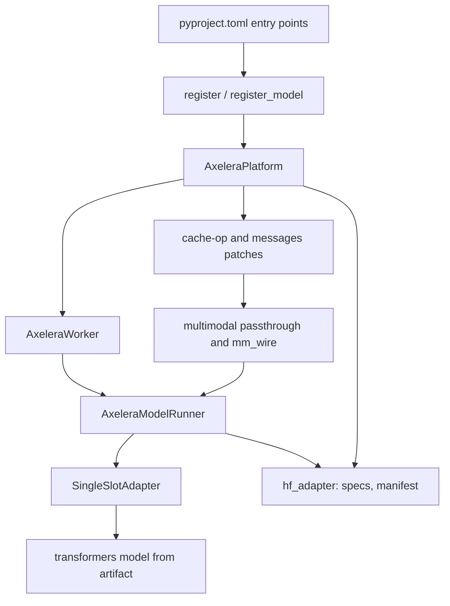

# axplugin

## Overview

`axplugin` is an out-of-tree vLLM plugin that runs compiled Axelera Metis artifacts.
It presents the host to vLLM as a CPU platform and replaces vLLM's model runner with one that drives a compiled artifact.
The artifact holds the whole model, including attention and the KV cache, so vLLM allocates no KV cache.
`SingleSlotAdapter` serves one live request at a time. Each artifact family has a `SingleSlotSpec` that builds its inputs.
`serve.sh` and the vLLM OpenAI API server load the plugin (see [serving.md](serving.md)).

## Architecture



`pyproject.toml` declares two entry points. `vllm.platform_plugins` points to `axplugin:register`. `vllm.general_plugins` points to `axplugin:register_model`.
Both functions do nothing when `axelera.runtime` is not importable. `register` then returns `None`.
`AxeleraPlatform.check_and_update_config` adapts the vLLM config to the artifact manifest and installs two process-wide patches.
`AxeleraWorker` subclasses vLLM's `Worker` and creates an `AxeleraModelRunner`.
The runner reads the Metis device and temperature from `additional_config`, loads the adapter and calls it for every scheduler step.
`hf_adapter.SINGLE_SLOT_SPECS` maps the `model_type` in the artifact `config.json` to a `SingleSlotSpec`.
The marker classes in `model.py` satisfy vLLM's model registry. Inference never runs through them.

## Components

| Component | Description | Reference |
|---|---|---|
| `register`, `register_model` | Entry points. `register_model` registers each spec's marker class under its architecture name. | [axplugin index](../reference/axplugin/index.md) |
| `AxeleraPlatform` | Platform with `device_type` `cpu`. It forces the config limits below. | [axplugin index](../reference/axplugin/index.md) |
| `disable_accelerator_cache_ops` | Replaces `torch.accelerator` `synchronize`, `empty_cache` and `empty_host_cache` with no-ops. | [axplugin index](../reference/axplugin/index.md) |
| `install_messages_passthrough_patch` | Wraps `HfRenderer.render_messages` and `render_messages_async` to add the chat messages to `multi_modal_data`. | [axplugin index](../reference/axplugin/index.md) |
| `AxeleraWorker` | Worker that skips memory profiling, KV cache setup, compilation and sleep mode. | [axplugin index](../reference/axplugin/index.md) |
| `AxeleraModelRunner` | Loads the artifact and runs scheduler steps through `SingleSlotAdapter`. | [axplugin index](../reference/axplugin/index.md) |
| `SingleSlotSpec` | Describes a model family: architecture, Auto class, manifest file, input builder and marker class. | [axplugin index](../reference/axplugin/index.md) |
| `SingleSlotAdapter` | Prefills and decodes one sequence at a time. | [axplugin index](../reference/axplugin/index.md) |
| `sample_next_token` | Picks a token id from logits. It uses argmax at temperature 0 and softmax sampling otherwise. | [axplugin index](../reference/axplugin/index.md) |
| `ArtifactManifest` | `context_len`, `cache_batch` (always 1) and `repo_id` of an artifact. | [axplugin index](../reference/axplugin/index.md) |
| `AxSingleSlotTextModel` | Marker class for text-only artifacts. | [axplugin index](../reference/axplugin/index.md) |
| `AxSingleSlotVisionModel` | Marker class for image and text artifacts. It accepts image placeholders only. | [axplugin index](../reference/axplugin/index.md) |
| `AxPassthroughProcessingInfo`, `AxPassthroughMultiModalProcessor`, `AxPassthroughDummyInputsBuilder` | Passthrough classes that carry raw images and chat messages to the runner. | [axplugin index](../reference/axplugin/index.md) |
| `mm_wire` | Encodes images and chat messages as uint8 tensors and decodes them. | [axplugin index](../reference/axplugin/index.md) |

Supported model families in `SINGLE_SLOT_SPECS`:

| `model_type` | Architecture | Auto class | Manifest file |
|---|---|---|---|
| `ax_causal_lm` | `AxQwen3SingleSlotForCausalLM` | `AutoModelForCausalLM` | `pipeline.json` |
| `ax_smolvlm` | `SmolVLMForConditionalGeneration` | `AutoModelForImageTextToText` | `vlm.json` |

## Flow

1. vLLM loads the entry points. `register_model` registers the marker classes.
2. `serve.sh` passes `--hf-overrides` from `hf_overrides_for`. The function returns `{"architectures": [...]}` when `config.json` has no `architectures` and the `model_type` is known.
3. `check_and_update_config` resolves the artifact directory and reads the manifest. It applies the limits listed under Constraints.
4. `AxeleraWorker.init_device` creates `AxeleraModelRunner`. `load_model` loads the artifact through the transformers Auto class and builds `SingleSlotAdapter`.
5. The chat route sends images through the passthrough processor. `mm_wire` encodes them for the engine process.
6. For a new request, the runner calls `SingleSlotAdapter.admit`. The adapter builds the inputs, runs the prefill and samples the first token.
7. For a running request, the runner calls `SingleSlotAdapter.step`. The adapter decodes one token per call.
8. A request ends when the sampled token is in the model's `generation_config.eos_token_id` or the token budget is reached.
9. On shutdown, `AxeleraWorker.shutdown` calls `AxeleraModelRunner.close`. The runner calls `release` on the model.

## Configuration

The runner reads these `additional_config` keys. `serve.sh` sets `device` and `temperature`.

| Key | Default | Effect |
|---|---|---|
| `device` | data-parallel device index | Metis device. The runner exports it as `AXELERA_METIS_DEVICE`. |
| `temperature` | `0.0` | Sampling temperature for the whole process. |
| `artifact_dir` | `model_config.model` | Artifact directory. `serve.sh` does not set it. |

| Parameter | Scope | Effect |
|---|---|---|
| `temperature` | Process | A request with a different `SamplingParams.temperature` triggers one warning. The backend ignores it. |
| `max_tokens` | Request | Token budget of the request. The initial default is `max_model_len`, or the manifest `context_len` if unset. Each admitted request replaces the default with its own budget. |
| Thinking mode | Process default, request override | `serve.sh` sets the chat-template default through `--default-chat-template-kwargs`. |

## Constraints

- `AxeleraPlatform` raises `NotImplementedError` when `world_size` is greater than 1. Use `--data-parallel-size` to scale out.
- The platform forces `enforce_eager`. It disables chunked prefill, prefix caching, async scheduling and the multimodal processor cache.
- The platform caps `max_num_seqs` to the manifest `cache_batch`, which is 1.
- The platform caps `max_model_len` to the manifest `context_len`. It raises `max_num_batched_tokens` to at least `context_len`.
- `SingleSlotAdapter.admit` raises `RuntimeError` while a request is live. The adapter is not thread-safe.
- vLLM's own scheduler queues the requests. The plugin has no queue-depth setting.
- Per-request temperature does not exist. Use one server process per temperature.
- The `ax_causal_lm` spec raises `ValueError` when its input builder receives images.
- `load_model_class` and `read_manifest` raise `ValueError` when no spec matches the artifact `model_type`.
- `AxeleraWorker.sleep` and `wake_up` log a warning and do nothing.
- `AxeleraPlatform.get_attn_backend_cls` always raises. The models are attention-free.
- The SmolVLM2 input builder places images into chat messages in order. Each `image` content item without an `image` key takes the next image.
- The multimodal processor accepts any number of images and one `messages` item per prompt.
- The platform patches are process-wide. `install_messages_passthrough_patch` installs once per process.

## Quick Example

Check which `hf_overrides` an artifact needs and which spec it resolves to.

```bash
cd server/vllm/axelera
python3 -c '
import sys
from pathlib import Path
from axplugin import hf_adapter
d = Path(sys.argv[1])
print(hf_adapter.hf_overrides_for(d))
print(hf_adapter.resolve_single_slot_spec(d))
' "$SDK_DIR/build/qwen3-0.6b/axscript"
```

Run it with the vLLM environment Python (`AXELERA_PYTHON`).

## Related

- [serving.md](serving.md)
- [pipeline.md](../vision/pipeline.md)
- [tuning.md](../tuning/tuning.md)

## Source files

- `server/vllm/axelera/pyproject.toml`
- `server/vllm/axelera/axplugin/__init__.py`
- `server/vllm/axelera/axplugin/platform.py`
- `server/vllm/axelera/axplugin/worker.py`
- `server/vllm/axelera/axplugin/model_runner.py`
- `server/vllm/axelera/axplugin/hf_adapter.py`
- `server/vllm/axelera/axplugin/single_slot.py`
- `server/vllm/axelera/axplugin/model.py`
- `server/vllm/axelera/axplugin/multimodal.py`
- `server/vllm/axelera/axplugin/mm_wire.py`
