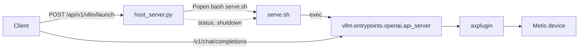

# vLLM serving on Axelera

## Overview

The server serves compiled LLM and VLM artifacts through vLLM's OpenAI-compatible HTTP API.
The script `server/vllm/axelera/scripts/serve.sh` starts the vLLM API server for one artifact on one Metis device.
The `host_server.py` vLLM endpoints launch, track and stop `serve.sh` processes.
Clients send inference requests directly to the vLLM port. They do not send them through `host_server.py`.
Operators and the client helper use this path to run models such as `qwen3-0.6b` and `smolvlm2-256m-video-instruct`.

## Architecture



`host_server.py` is the control plane. It runs `serve.sh` in a subprocess and records the process under its `name`.
`serve.sh` checks that `axelera.runtime` imports. It asks `axplugin.hf_adapter.hf_overrides_for` for `--hf-overrides` and then execs the vLLM API server.
The vLLM server is the data plane. It loads the artifact through the `axplugin` package (see [axplugin.md](axplugin.md)).
`serve.sh` always passes `--enforce-eager` and exports `HF_HUB_OFFLINE=1`. It never passes `--served-model-name`.
vLLM then names the model after `MODEL`, the artifact directory path.

## Components

| Component | Description | Reference |
|---|---|---|
| `serve.sh` | Starts the vLLM OpenAI-compatible server for one artifact. | [axplugin index](../reference/axplugin/index.md) |
| `GET /api/v1/vllm/artifacts` | Lists the `SDK_ROOT/build/<name>/axscript` directories. | [host_server index](../reference/host_server/index.md) |
| `POST /api/v1/vllm/launch` | Runs `serve.sh` and waits up to 180 s for the port to open. | [host_server index](../reference/host_server/index.md) |
| `POST /api/v1/vllm/shutdown` | Stops the instance tracked under a `name`. | [host_server index](../reference/host_server/index.md) |
| `GET /api/v1/vllm/status` | Lists tracked instances and whether each still runs. | [host_server index](../reference/host_server/index.md) |

All four routes require the `X-API-Key` header. See [host-server.md](../host-server/host-server.md) for authentication and the other routes.

## Flow

1. The client calls `POST /api/v1/vllm/launch` with `name`, `artifact`, `port` and `device`.
2. `host_server.py` resolves `artifact` against `SDK_ROOT`. It replaces `${SDK_ROOT}` and treats a relative path as relative to `SDK_ROOT`.
3. The server stops any instance already tracked under the same `name`.
4. The server reads `context_len` from `vlm.json` or `pipeline.json` in the artifact directory.
5. The server runs `bash serve.sh` with the environment variables below. It writes output to `<VLLM_LOG_DIR>/<name>.log`.
6. `serve.sh` execs the vLLM API server. The server opens the port.
7. `host_server.py` returns `pid`, `port` and `context_length`. It tracks the process.
8. The client calls `GET /v1/models` on the vLLM port to read the model id.
9. The client sends requests to `/v1/chat/completions` or `/v1/completions` on the vLLM port.
10. The client calls `POST /api/v1/vllm/shutdown` with the `name` to stop the server and free the device.

## Configuration

`host_server.py` sets these `serve.sh` variables. Most come from the launch request. It also sets `PYTHONPATH` to `SDK_ROOT`.

| Variable | Default | Effect |
|---|---|---|
| `MODEL` | none (required) | Artifact directory. `serve.sh` exits with code 1 if it is not a directory. |
| `PORT` | `8000` | Port of the vLLM server. |
| `DEVICE` | `metis-0:23:0` | Metis device id. The server passes it in `--additional-config`. |
| `THINKING` | `off` | `off` adds `--default-chat-template-kwargs '{"enable_thinking": false}'`. Any other value leaves thinking on. |
| `TEMPERATURE` | `0.0` | Sampling temperature. It is fixed for the process. |
| `AXELERA_PYTHON` | `<pkg>/.venv/bin/python`, else `python3` | Python interpreter. `host_server.py` sets it to `VLLM_VENV_PYTHON`. |

Extra arguments to `serve.sh` pass through to the vLLM server.

The launch request fields map to these variables.

| Field | Type | Default | Effect |
|---|---|---|---|
| `name` | string | required | Tracking key and log file name. It must match `^[A-Za-z0-9_-]{1,100}$`. |
| `artifact` | string | required | Artifact directory. It becomes `MODEL`. |
| `port` | int | required | Becomes `PORT`. |
| `device` | string | required | Becomes `DEVICE`. |
| `enable_thinking` | bool | `false` | Sets `THINKING` to `on` or `off`. |
| `temperature` | float | `0.0` | Becomes `TEMPERATURE`. |

`host_server.py` reads these environment variables.

| Variable | Default | Effect |
|---|---|---|
| `VLLM_AXELERA_DIR` | `server/vllm/axelera` in the repo | Directory that holds `scripts/serve.sh`. |
| `VLLM_VENV_PYTHON` | `.venv-vllm/bin/python3` in the repo | Python of the vLLM environment. |
| `VLLM_LOG_DIR` | `deployment/vllm_logs` | Directory for the per-instance logs. |

## Constraints

- `MODEL` must be a compiled artifact directory. A Hugging Face repo id fails.
- A host with one device runs one vLLM server at a time. Stop the running server before you launch another.
- Each server needs its own `PORT`.
- The launch request requires `device`. Use the `name` field of an entry from `GET /api/v1/devices`.
- Temperature is fixed at launch. A different temperature needs a separate server process.
- `max_tokens` applies per request. `axplugin` caps `max_model_len` to the artifact `context_len` (see [axplugin.md](axplugin.md)).
- Read the model id from `/v1/models` instead of hardcoding it.
- The launch route returns 400 if the artifact directory is missing. It returns 500 if `serve.sh` or the vLLM Python is missing.
- The launch route returns 502 if the process exits or the port does not open within 180 s.
- The helper `python -m helper vllm up` derives `name` from `--artifact` unless you pass `--name`. It replaces each character outside `A-Za-z0-9_-` with a dash.
  `qwen3-0.6b` therefore becomes `qwen3-0-6b`. Use that name with `vllm down --name`.
- `POST /api/v1/vllm/shutdown` returns `stopped: false` for a `name` the server does not track.
- `GET /api/v1/vllm/status` reports `context_length` as `null` when no manifest provides one.

## Quick Example

Launch an artifact, read the model id, send a chat request and stop the server.
Set `BASE` to `http://<host>:8088` and `API_KEY` to `DEPLOYMENT_API_KEY`.

```bash
curl -sS -X POST "$BASE/api/v1/vllm/launch" \
  -H "X-API-Key: $API_KEY" -H "Content-Type: application/json" \
  -d '{"name": "vllm-1", "artifact": "${SDK_ROOT}/build/smolvlm2-256m-video-instruct/axscript",
       "port": 8001, "device": "metis-0:1:0"}'

MODEL_ID="$(curl -sS http://<host>:8001/v1/models | python3 -c 'import json,sys; print(json.load(sys.stdin)["data"][0]["id"])')"

curl -sS http://<host>:8001/v1/chat/completions -H "Content-Type: application/json" \
  -d "{\"model\": \"$MODEL_ID\", \"messages\": [{\"role\": \"user\", \"content\": \"Tell me a joke.\"}]}"

curl -sS -X POST "$BASE/api/v1/vllm/shutdown" \
  -H "X-API-Key: $API_KEY" -H "Content-Type: application/json" -d '{"name": "vllm-1"}'
```

The commands to deploy artifacts, start `serve.sh` by hand and send image requests are in [QUICKSTART.md](../../QUICKSTART.md).

## Related

- [axplugin.md](axplugin.md)
- [host-server.md](../host-server/host-server.md)
- [tuning.md](../tuning/tuning.md)
- [QUICKSTART.md](../../QUICKSTART.md)

## Source files

- `server/vllm/axelera/scripts/serve.sh`
- `deployment/host_server.py`
- `deployment/launch_remote.py`
- `server/models/deploy_to_sdk.sh`
- `client/examples/helper/__main__.py`
- `client/examples/helper/server.py`
